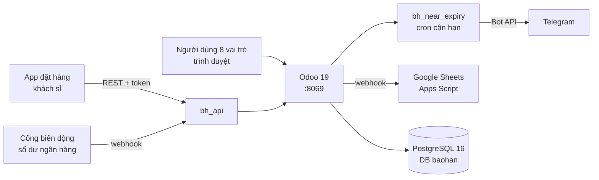

<div align="center">

# 🥐 Bảo Hân ERP

### Triển khai Odoo 19 cho xưởng sản xuất bánh

**Đồ án môn Hoạch định nguồn lực doanh nghiệp · IS336.R12**<br>
Trường Đại học Công nghệ Thông tin · ĐHQG TP. Hồ Chí Minh


[Giới thiệu](#giới-thiệu) · [Quy trình](#năm-quy-trình-nghiệp-vụ) · [Điểm khác biệt](#điểm-khác-biệt) · [Kiến trúc](#kiến-trúc-hệ-thống) · [Cài đặt](#cài-đặt-và-chạy-dự-án) · [Thành viên](#thành-viên-nhóm)

</div>

---

## Thông tin đồ án

| Nội dung | Thông tin |
|---|---|
| Đề tài | Triển khai hệ thống ERP Odoo 19 cho Công ty TNHH Bánh Bảo Hân |
| Môn học | IS336 — Hoạch định nguồn lực doanh nghiệp |
| Lớp | IS336.R12 |
| Nhóm | 06 |
| Giảng viên hướng dẫn | ThS. Văn Đức Sơn Hà |
| Nền tảng | Odoo 19 Community tự cài bằng Docker (DB `baohan`) |
| Dữ liệu demo | Tuần đầu go-live 14–18/11/2026, sinh bằng script |

## Giới thiệu

Công ty TNHH Bánh Bảo Hân là xưởng sản xuất bánh tươi và bánh cấp đông tại TP. Thủ Đức, bán sỉ cho quán, siêu thị, bếp ăn, trường học và nhận gia công OEM. Sản phẩm hạn dùng ngắn (3–5 ngày), giao theo tuyến mỗi sáng, nhiều khách mua chịu: đây là bài toán điển hình cho ERP doanh nghiệp sản xuất.

> **Về dữ liệu:** tên, mã số thuế, địa chỉ công ty là thông tin công khai. Nhân sự, khách hàng, nhà cung cấp, giá, định mức và mọi số liệu nội bộ là **giả định** phục vụ học tập. Nhóm chưa phỏng vấn doanh nghiệp; phỏng vấn mô phỏng 32 câu ở mục 1.6 [`baocao/chuong1.md`](baocao/chuong1.md), mẫu biên bản ở [`baocao/phuluc_A_phong_van.md`](baocao/phuluc_A_phong_van.md). Ảnh website là ảnh minh họa có giấy phép miễn phí, không phải ảnh sản phẩm thật.

Thiết kế quy trình bám theo nhịp một ngày vận hành thật của xưởng: ai làm, lúc mấy giờ, thay cho giấy tờ nào. Odoo sản xuất dành cho **quản đốc**, thợ đứng lò không phải dùng máy. Chi tiết và lý do từng quyết định ở [`RA_SOAT_QUY_TRINH.md`](RA_SOAT_QUY_TRINH.md).

## Năm quy trình nghiệp vụ

| Mã | Phân hệ | Nội dung chính | BPMN |
|---|---|---|---|
| QT1 | Bán hàng | Bảng giá theo nhóm khách, chặn đơn khi nợ quá hạn, soạn hàng theo tuyến, hóa đơn theo số giao thực tế, trả hàng | [QT1](bpmn/QT1_ban_hang.png) |
| QT2 | Mua hàng | Bổ sung NVL theo điểm đặt hàng, hợp đồng giá NCC, duyệt đơn trên 20 triệu, kiểm tra chất lượng tại cửa | [QT2](bpmn/QT2_mua_hang.png) |
| QT3 | Sản xuất | Mẻ hằng ngày cho quản đốc: BoM có công đoạn và phụ phẩm, cấp NVL 2 bước, lô theo ngày, QC thành phẩm, phế phẩm, đóng lệnh làm thiếu | [QT3](bpmn/QT3_san_xuat.png) |
| QT4 | Kho | Vị trí kho khô/mát/đông, xuất FEFO, khu cách ly, cận hạn nhiều mức, thu hồi lô ở điểm bán, kiểm kê | [QT4](bpmn/QT4_kho_can_han.png) |
| QT5 | Kế toán công nợ | Phải thu/phải trả, đối soát ngân hàng tự động qua webhook, giá vốn, báo cáo tuổi nợ | [QT5](bpmn/QT5_ke_toan_cong_no.png) |

Kiểm soát chất lượng nằm trong QT2 (nhận hàng) và QT3 (thành phẩm), dùng module OCA `quality_control_oca`.

## Điểm khác biệt

- **Chặn công nợ tự động** (Automation Rule BH2a/BH2b): khách có hóa đơn quá hạn không xác nhận được đơn mới cho tới khi giám đốc gắn nhãn duyệt.
- **Sản xuất cho quản đốc:** quản đốc lập lệnh từ màn hình Bổ sung hàng, ghi sản lượng thực tế và lô theo ngày; QC tạo phiếu kiểm tự động (BH5).
- **Module `bh_near_expiry`** (tự viết, 3 test): chính sách cận hạn nhiều mức theo % hạn dùng còn lại cho từng nhóm hàng, giao việc giảm giá / thu hồi / hủy, tìm lô đang nằm ở điểm bán của khách, cảnh báo Telegram, báo cáo tổn thất.
- **Module `bh_api`** (tự viết, 12 test): REST API cho app đặt hàng của khách sỉ (token băm SHA-256, phạm vi quyền, giới hạn tần suất, nhật ký) và webhook nhận biến động số dư kiểu SePay, tự khớp số hóa đơn và ghi nhận thanh toán.
- **Theme `theme_custom_website`**: website bán sỉ và gia công OEM, kiểm tra trên desktop và mobile.

## Công nghệ sử dụng

| Thành phần | Công nghệ |
|---|---|
| ERP | Odoo 19 Community: Sales, Purchase, Inventory, MRP, Accounting (`l10n_vn`), CRM, Website, Automation |
| Module cộng đồng | OCA 19.0: `quality_control_oca`, `account_financial_report`, `partner_statement` (+ `date_range`, `report_xlsx`) |
| Module tự viết | `bh_near_expiry`, `bh_api`, `theme_custom_website` (Python, XML/QWeb, SCSS) |
| Hạ tầng | Docker Compose: `odoo:19.0` + `postgres:16` |
| Dữ liệu và kịch bản | Script Python chạy trong `odoo shell` |
| Tích hợp | REST API + webhook, JSON-2 API, XML-RPC, Google Apps Script, Telegram Bot API |
| Mô hình hóa | BPMN 2.0 (sinh bằng Python, mở được bằng Camunda Modeler) |
| Báo cáo | Markdown → Word (`python-docx`), ảnh chụp tự động bằng Playwright |

## Kiến trúc hệ thống



Server chạy với `--db-filter=^baohan$` để API và webhook không phải chọn database.

## Cấu trúc dự án

<details>
<summary><b>Xem cấu trúc thư mục</b></summary>

```text
IS336_Odoo/
├── odoo_local/
│   ├── docker-compose.yml           # Odoo 19 + PostgreSQL 16
│   ├── addons/
│   │   ├── bh_near_expiry/          # Module quản lý hàng cận hạn
│   │   ├── bh_api/                  # REST API đối tác + webhook ngân hàng
│   │   └── theme_custom_website/    # Theme website Bảo Hân Bakery
│   └── oca/                         # Submodule OCA 19.0
├── scripts/
│   ├── rebuild_all.sh               # Dựng lại toàn bộ DB baohan
│   ├── seed_data.py                 # Nguồn dữ liệu nền duy nhất
│   ├── seed_odoo.py                 # Nạp cấu hình + dữ liệu nền
│   ├── automation_rules.py          # Quy tắc tự động BH1–BH5
│   ├── demo_week.py                 # Kịch bản tuần go-live 14–18/11
│   ├── api_demo_calls.py            # Gọi bh_api và webhook qua HTTP
│   └── api_ca_nhan/                 # JSON-2 và XML-RPC
├── data/                            # File import CSV/XLSX, tài khoản thử
├── bpmn/                            # QT1–QT5 (.bpmn + .png)
├── integrations/                    # Apps Script, hướng dẫn tích hợp
├── baocao/                          # Nội dung báo cáo (.md) + ảnh chụp
├── tools/                           # Sinh BPMN, chụp màn hình, dựng .docx
├── Report - Nhóm 06.docx            # Báo cáo hoàn chỉnh
├── RA_SOAT_QUY_TRINH.md             # Thiết kế 5 quy trình, chấm độ khó, phân công
├── HUONG_DAN_CAI_DAT.md             # Cài đặt, dựng lại, kịch bản quay video
├── HUONG_DAN_KIEM_TRA.md            # Danh sách màn hình cần kiểm
├── KIEN_THUC_VAN_DAP.md             # Ôn vấn đáp
└── PROGRESS.md                      # Nhật ký tiến độ và lưu ý kỹ thuật
```

</details>

## Cài đặt và chạy dự án

<details open>
<summary><b>Dựng toàn bộ hệ thống trên Windows (khoảng 30 phút lần đầu)</b></summary>

### 1. Yêu cầu môi trường

- **Docker Desktop** (đang chạy).
- **Git for Windows** kèm Git Bash.
- **Python 3.12+** cho script gọi API, dựng báo cáo: `pip install python-docx openpyxl requests pillow playwright`.
- **Camunda Modeler** (tùy chọn) để mở và xuất ảnh BPMN.

### 2. Clone repository kèm module OCA

```powershell
git clone --recurse-submodules https://github.com/tienlelttt/IS336_Odoo.git
cd IS336_Odoo
```

Đã clone mà thiếu `odoo_local/oca`: chạy `git submodule update --init --depth 1`.

### 3. Dựng database `baohan`

Trong **Git Bash**, thư mục `odoo_local`:

```bash
docker compose up -d db
bash ../scripts/rebuild_all.sh
```

Script xóa DB `baohan` nếu có, rồi: cài 19 module → áp theme → dữ liệu nền → quy tắc tự động → tuần go-live → bật Odoo. Khoảng 5 phút (lần đầu tải image khoảng 1 GB).

### 4. Đăng nhập

| Địa chỉ | Tài khoản |
|---|---|
| http://localhost:8069 | `admin` / `admin` |
| 8 vai trò nghiệp vụ | `giamdoc@baohan.local`, `kinhdoanh1@…`, `muahang@…`, `quandoc@…`, `qc@…`, `thukho@…`, `ketoan@…` — xem [`data/README.md`](data/README.md) |

Các mật khẩu trên chỉ dành cho máy local. Đổi ngay nếu đưa lên máy chủ thật.

### 5. Lệnh hằng ngày (Git Bash, thư mục `odoo_local`)

| Việc | Lệnh |
|---|---|
| Bật / tắt | `docker compose up -d` / `docker compose stop` |
| Xem log | `docker compose logs odoo --tail 100` |
| Sao lưu | `docker compose exec -T db pg_dump -U odoo -Fc baohan > ../backups/baohan_$(date +%Y%m%d).dump` |
| Cập nhật module | `MSYS_NO_PATHCONV=1 docker compose run --rm -T odoo -- -d baohan -u bh_near_expiry --stop-after-init --addons-path=<như trong docker-compose.yml>` |

</details>

<details>
<summary><b>Lưu ý khi chạy trên Windows</b></summary>

- Lệnh `docker compose run/exec` trong Git Bash phải có `MSYS_NO_PATHCONV=1` (script đã có sẵn).
- Khi `-u`/`-i` module trên `baohan` phải kèm `--addons-path` có các thư mục `/mnt/oca/...`, nếu không Odoo báo thiếu module.
- Odoo kiểm ngày rút khỏi kệ của lô theo giờ thật, nên dữ liệu demo là tuần go-live chứ không giả lập lùi nhiều tuần.
- Định giá kho "Perpetual (at invoicing)": bút toán giá vốn 632/155 ghi lúc lập hóa đơn.

Các lỗi đã gặp và cách xử lý: [`PROGRESS.md`](PROGRESS.md).

</details>

## Kiểm thử

Chạy test của module tự viết trên một DB thử (không chạy trên `baohan`):

```bash
MSYS_NO_PATHCONV=1 docker compose run --rm -T odoo -- -d bh_test -i bh_near_expiry,bh_api \
  --test-tags /bh_near_expiry,/bh_api --stop-after-init
```

| Module | Số test | Nội dung |
|---|:---:|---|
| `bh_near_expiry` | 3 | Phân mức theo % hạn dùng còn lại, không tạo trùng và chỉ nâng mức, hủy lô ghi nhận tổn thất |
| `bh_api` | 12 | Xác thực, token băm, phạm vi, tạo/đọc đơn, chặn xem đơn khách khác, dữ liệu sai, giới hạn tần suất, token hết hạn, webhook khớp hóa đơn, giao dịch trùng, không khớp |

Gọi API thật qua HTTP: `BH_API_TOKEN=<token> python scripts/api_demo_calls.py` (token demo: Tham số hệ thống `bh_demo.api_token_kh02`). Danh sách màn hình kiểm tra thủ công: [`HUONG_DAN_KIEM_TRA.md`](HUONG_DAN_KIEM_TRA.md).

## Dựng lại báo cáo

```bash
python tools/chup_man_hinh.py          # chụp lại ảnh (Odoo phải đang chạy)
python tools/md2docx.py "Report - Nhóm 06.docx" baocao/00_mo_dau.md baocao/chuong1.md ... baocao/phuluc_A_phong_van.md
python tools/bpmn_gen.py               # sinh lại 6 BPMN (tổng quan + 5 quy trình) từ tools/bpmn_specs.py
```

`md2docx.py` dùng file mẫu định dạng của môn (`GIới-thiệu-đề-tài.docx`) đặt ở thư mục cha của repo; file này không nằm trong repository. Lệnh đầy đủ ở [`HUONG_DAN_CAI_DAT.md`](HUONG_DAN_CAI_DAT.md#phần-4-dựng-báo-cáo-word).

## Thành viên nhóm

<p align="center">
  <a href="https://github.com/tienlelttt"></a>
  &nbsp;
  <a href="https://github.com/ThorBietBay001"></a>
  &nbsp;
  <a href="https://github.com/haiphamt"></a>
</p>

| STT | MSSV | Họ và tên | Vai trò chính | GitHub |
|:---:|---|---|---|---|
| 1 | 24521769 | **Lê Thị Thanh Tiền** | B: QT3 Sản xuất, cận hạn, JSON-2 (34%) | [tienlelttt](https://github.com/tienlelttt) |
| 2 | 24521817 | Đoàn Thị Thùy Trang | A: QT1 Bán hàng, phải thu, `bh_api`, website (33%) | [ThorBietBay001](https://github.com/ThorBietBay001) |
| 3 | 24520442 | Phạm Tuấn Hải | C: QT2 Mua hàng, kho, phải trả, Automation, XML-RPC (33%) | [haiphamt](https://github.com/haiphamt) |

Chi tiết phân công ở chương 9 báo cáo; cơ sở chia vai trò ở mục 6.2 [`RA_SOAT_QUY_TRINH.md`](RA_SOAT_QUY_TRINH.md).

## Giấy phép

Module tự viết phát hành theo **LGPL-3** (như khai báo trong `__manifest__.py`). Module OCA giữ giấy phép gốc của từng repository. Nguồn ảnh website: [`CREDITS.md`](odoo_local/addons/theme_custom_website/static/src/img/CREDITS.md).
