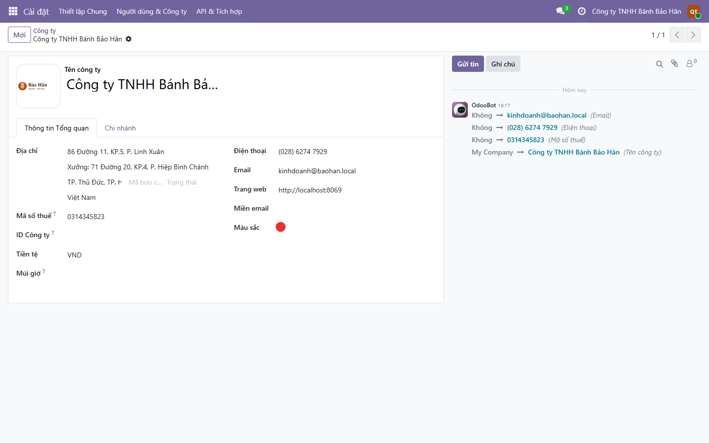
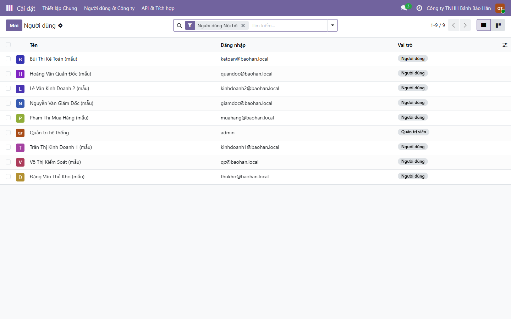
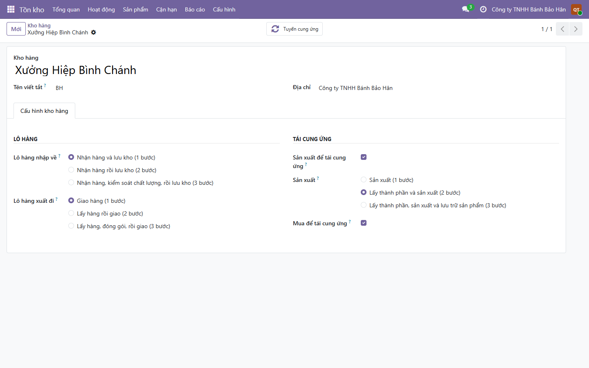
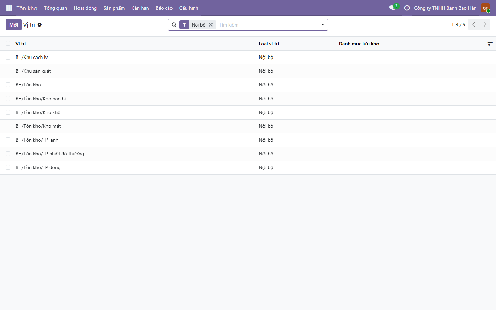
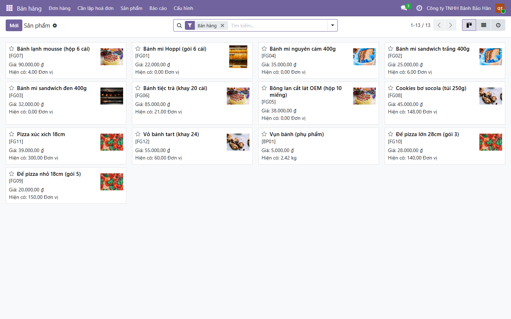
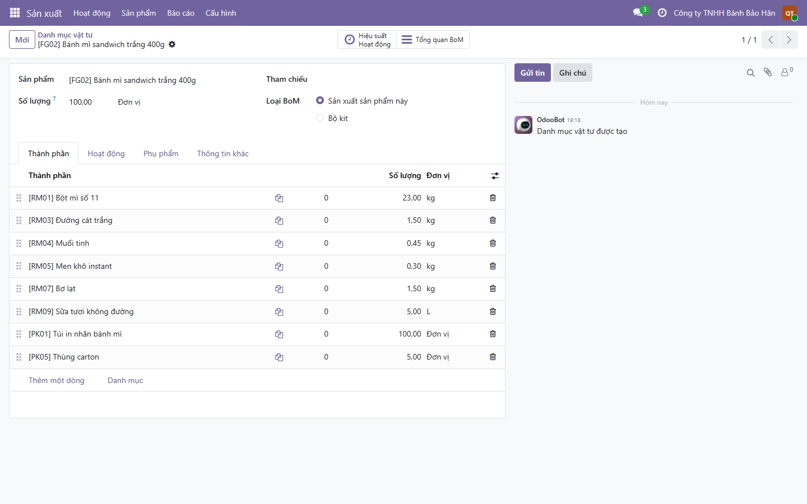
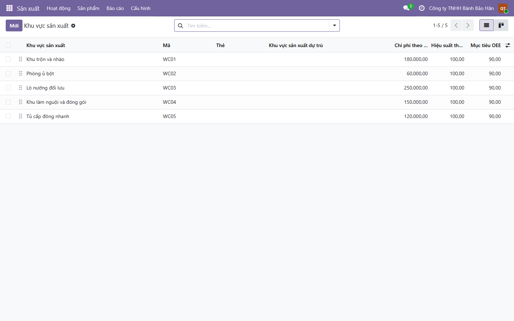
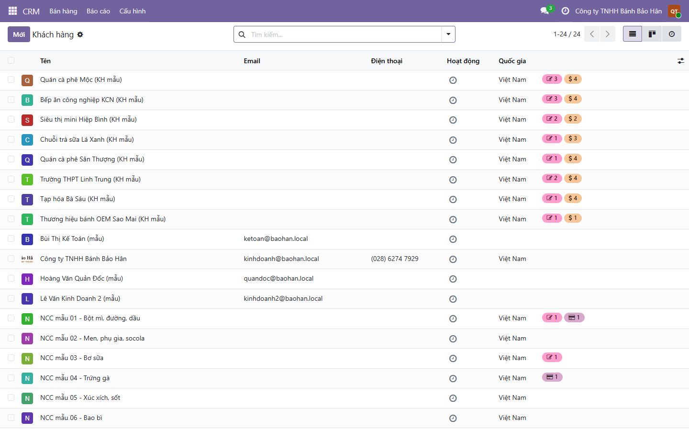
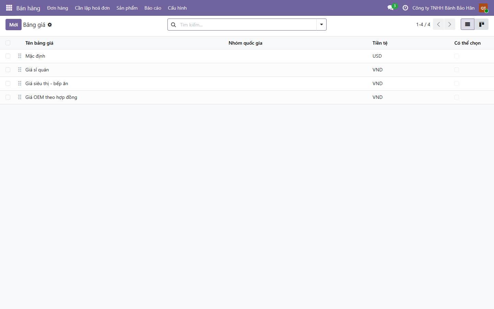
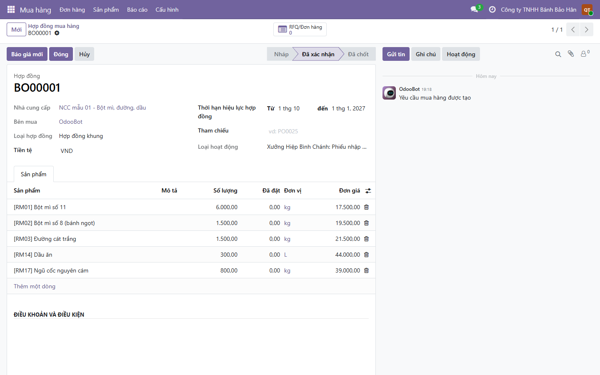

# CHƯƠNG 4. CÀI ĐẶT, CẤU HÌNH VÀ DỮ LIỆU NỀN

## 4.1. Cài đặt Odoo 19

Hệ thống chạy bằng Docker Compose trên máy của nhóm (chi tiết từng lệnh ở tài liệu HUONG_DAN_CAI_DAT.md):

| Bước | Việc | Kết quả |
|---|---|---|
| 1 | Cài Docker Desktop | Môi trường container |
| 2 | Tạo `docker-compose.yml`: dịch vụ `db` (postgres:16) và `odoo` (odoo:19.0), cổng 8069, gắn thư mục `addons` (module tự viết) và `oca` (module cộng đồng) | 2 container |
| 3 | Tải các kho OCA nhánh 19.0 (manufacture, account-financial-reporting, server-ux, reporting-engine) | Module Quality, báo cáo tài chính |
| 4 | Tạo DB `baohan`, cài module, nạp tiếng Việt | Hệ thống sẵn sàng |
| 5 | Chạy script cấu hình và dữ liệu nền (`scripts/seed_odoo.py`) | Công ty, người dùng, sản phẩm, BoM… |

Lý do chọn tự cài thay vì Odoo Online: module Python tự viết (cận hạn, API) không cài được trên Odoo Online; tự cài cho phép một cơ sở dữ liệu duy nhất chứa cả phân hệ chuẩn và module riêng (chương 8).

## 4.2. Cấu hình chung

### 4.2.1. Công ty, tiền tệ, ngôn ngữ

Công ty TNHH Bánh Bảo Hân, MST 0314345823, địa chỉ trụ sở và xưởng; quốc gia Việt Nam; hệ thống tài khoản Việt Nam; tiền tệ VND; ngôn ngữ Tiếng Việt và English.

### 4.2.2. Người dùng, phân quyền, avatar

8 người dùng theo ma trận phân quyền ở mục 3.4. Tài khoản quản trị đổi tên "Quản trị hệ thống" và đổi avatar.

### 4.2.3. Gửi thư và mẫu chứng từ

Máy chủ gửi thư Gmail SMTP (smtp.gmail.com, cổng 587, STARTTLS) dùng mật khẩu ứng dụng của Gmail. Mẫu chứng từ dùng khung "Boxed", màu caramel #A84B16, logo và chân trang có MST, hotline.

### 4.2.4. Kho và vị trí

Kho "Xưởng Hiệp Bình Chánh" (BH): nhận hàng 1 bước, giao hàng 1 bước, sản xuất 2 bước. Vị trí trong Tồn kho: Kho khô, Kho mát, Kho bao bì, TP nhiệt độ thường, TP lạnh, TP đông. Vị trí ngoài Tồn kho: Khu sản xuất (nhận NVL cấp cho ca) và Khu cách ly (hàng trả về, hàng hết hạn). Quy tắc cất hàng theo nhóm sản phẩm; chiến lược xuất FEFO.

### 4.2.5. Sản phẩm, nguyên vật liệu, đơn vị tính

12 thành phẩm theo dõi theo lô, có hạn dùng (bánh mì 5 ngày, bánh lạnh 3 ngày, bánh ngọt 15–30 ngày, cookies và cấp đông 180 ngày); 23 nguyên vật liệu và bao bì (hàng mát theo lô); phụ phẩm vụn bánh. Đơn vị "Thùng 20" cho bán sỉ.

### 4.2.6. Định mức và khu vực sản xuất

BoM theo mẻ với định mức theo khối lượng thực tế (ví dụ bánh mì sandwich 400 g: mẻ 100 ổ dùng 23 kg bột), tối đa 4 công đoạn, phụ phẩm vụn bánh; 5 khu vực sản xuất có chi phí/giờ.

### 4.2.7. Khách hàng, bảng giá, hợp đồng giá

8 khách mẫu chia 3 tuyến; nhãn "Trả tiền mặt cho tài xế" cho quán nhỏ; bảng giá theo nhóm khách; hạn mức nợ cho khách trả sau. Hợp đồng giá theo quý với 3 nhà cung cấp chính.

## 4.3. Kỹ năng thao tác dữ liệu

### 4.3.1. Import / Export

Nhóm chuẩn bị file `data/master_data_bao_han.xlsx` và 4 file CSV (khách hàng, nhà cung cấp, thành phẩm, nguyên vật liệu). Cột là tên kỹ thuật của trường nên Odoo tự khớp; trường quan hệ ghi theo tên (bảng giá, điều khoản, nhãn, nhà cung cấp). Cả 4 file đã chạy thử ở chế độ Kiểm tra (dry-run) không lỗi.

Cách làm: mở danh sách → biểu tượng bánh răng → Nhập bản ghi → tải file → Kiểm tra → Nhập. Export: chọn bản ghi → Thao tác → Xuất → chọn trường → Excel.

Bài học rút ra: dữ liệu nền phải chuẩn hóa trước khi import (mã thống nhất, tên nhãn không chứa dấu phẩy vì Odoo dùng dấu phẩy để tách nhiều giá trị).

### 4.3.2. Bộ lọc, nhóm, lưu tìm kiếm

Ví dụ: Đơn bán → lọc nhãn "Tuyến 2" → nhóm theo Khách hàng → Lưu tìm kiếm hiện tại "Đơn tuyến 2". Lệnh sản xuất → nhóm theo Sản phẩm và Ngày → xem sản lượng. Việc cận hạn → lọc "Đang ở điểm bán" → nhóm theo Điểm bán để in danh sách thu hồi cho tài xế.

### 4.3.3. Báo cáo Pivot, Graph

Mỗi phân hệ có báo cáo sẵn (Phân tích bán hàng, mua hàng, hóa đơn; tải khu vực sản xuất) và module cận hạn có Pivot/Graph riêng (chương 5, mục báo cáo của từng quy trình).
