# CHƯƠNG 5. QUY TRÌNH NGHIỆP VỤ TRÊN HỆ THỐNG

Dữ liệu minh họa là tuần đầu go-live (14–18/11/2026): thứ Bảy chuyển số dư đầu kỳ, thứ Hai và thứ Ba vận hành trọn ngày, thứ Tư đang diễn ra. Mỗi quy trình gồm: mục tiêu, BPMN (file .bpmn trong thư mục `bpmn/`, mở bằng Camunda Modeler), đặc tả, minh họa trên Odoo, ngoại lệ và báo cáo.

## 5.1. QT1 – Nhận đơn, giao hàng, thu tiền (Order to Cash)

### 5.1.1. Mục tiêu và phạm vi

Nhận đơn sỉ đúng giá, không giao cho khách đang nợ quá hạn, giao đủ theo tuyến, lập hóa đơn theo số thực giao và thu tiền không sót. Khách chia 3 nhóm: quán và tạp hóa (đơn cố định hằng ngày, trả tiền mặt hoặc chuyển khoản ngay); siêu thị, bếp ăn, trường học (trả sau 30 ngày, có hạn mức nợ); OEM (hợp đồng riêng, làm theo đơn).

### 5.1.2. Mô hình BPMN

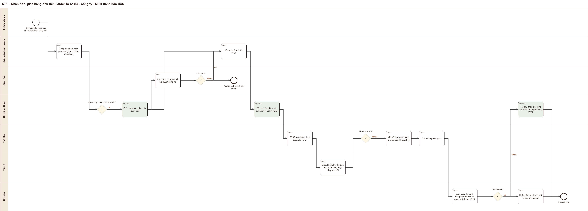

### 5.1.3. Đặc tả quy trình

| # | Bước | Người thực hiện | Mô tả | Màn hình / chứng từ Odoo |
|---|---|---|---|---|
| 1 | Nhận yêu cầu | Khách sỉ | Đặt bánh cho ngày mai qua Zalo, điện thoại, cổng khách hàng hoặc app (API) | – |
| 2 | Nhập đơn bán | NV kinh doanh | Chọn khách → bảng giá tự áp; ngày giao = ngày mai; đơn cố định nhân bản từ tuần trước | Bán hàng > Đơn hàng (đơn nháp) |
| 3 | Kiểm tra công nợ | Hệ thống | BH2a: khách có hóa đơn quá hạn hoặc vượt hạn mức → giao việc "Duyệt công nợ" cho giám đốc | Hoạt động trên đơn |
| 4 | Duyệt | Giám đốc | Xem công nợ, gọi khách; đồng ý thì gắn nhãn "Đã duyệt công nợ" | Nhãn trên đơn |
| 5 | Xác nhận đơn trước 16:00 | NV kinh doanh | BH2b chặn nếu chưa có nhãn duyệt | Đơn bán (đã xác nhận), phiếu giao |
| 6 | Đưa vào kế hoạch | Hệ thống | Tồn dự báo giảm → xuất hiện trong Bổ sung hàng (QT3) | – |
| 7 | Soạn hàng theo tuyến | Thủ kho, 05:00 | Gom phiếu giao của một tuyến thành một đợt; lô giữ theo FEFO | Đợt soạn hàng (Batch) |
| 8 | Giao hàng | Tài xế | Khách ký phiếu giao; quán nhỏ trả tiền mặt; nhận bánh thu hồi | Phiếu giao in (có lô, hạn dùng) |
| 9 | Xác nhận số thực giao | Thủ kho, 10:30 | Ghi số khách nhận; khách không nhận → hủy phiếu; hàng thu hồi → phiếu trả vào Khu cách ly | Phiếu giao done / hủy |
| 10 | Lập hóa đơn | Kế toán, 17:00 | Hóa đơn hàng loạt theo số đã giao; phát hành hóa đơn điện tử | Hóa đơn |
| 11 | Thu tiền | Kế toán | Tiền mặt tài xế nộp → nhật ký tiền mặt; chuyển khoản → webhook ngân hàng (QT5) | Thanh toán |
| 12 | Trả hàng | Kế toán | Hàng trả, hàng thiếu → giấy báo có | Giấy báo có |

### 5.1.4. Minh họa trên hệ thống

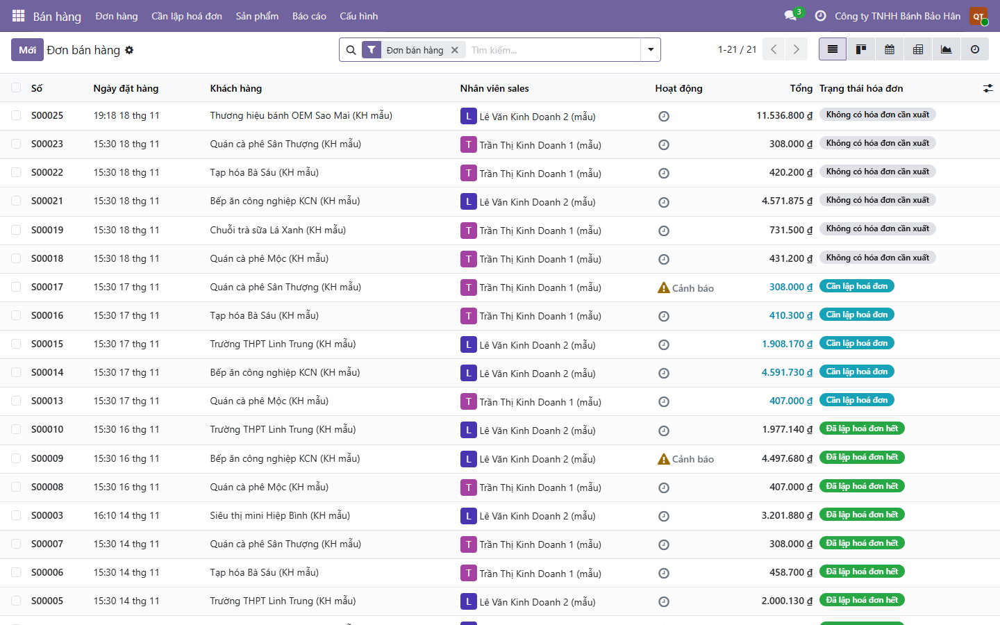

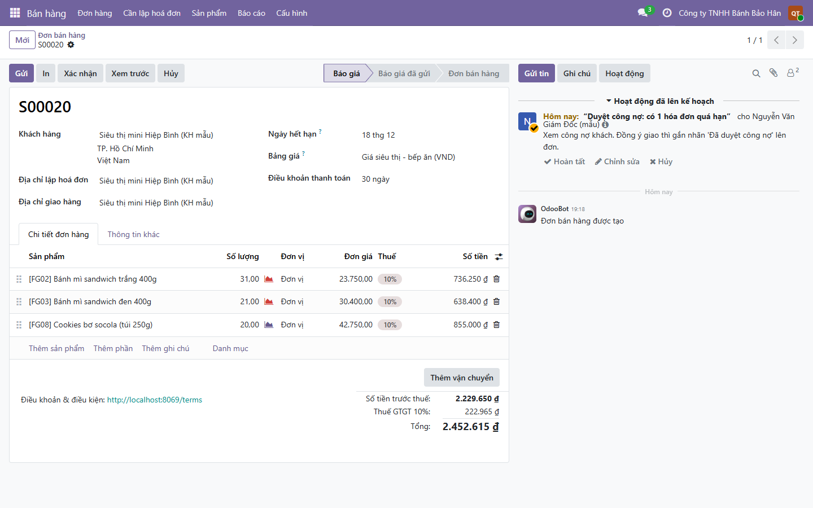

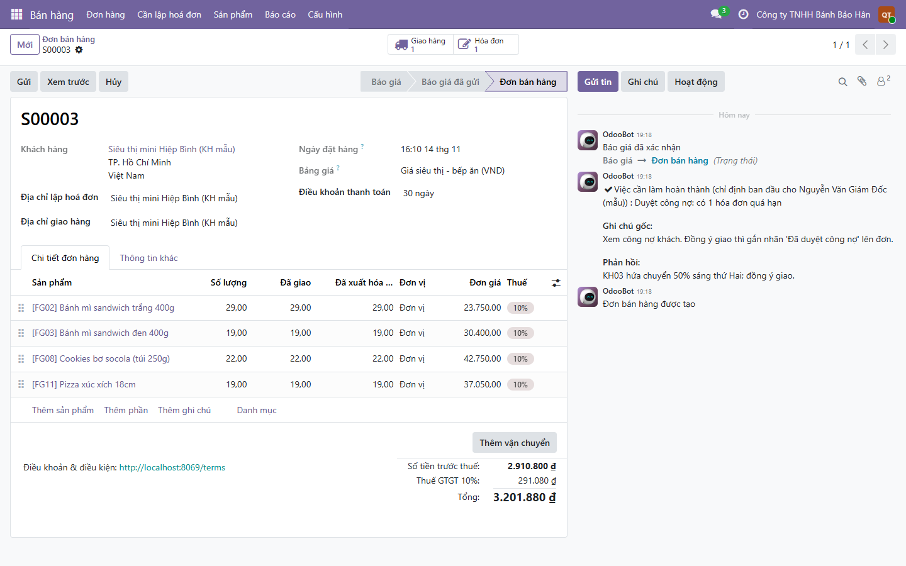

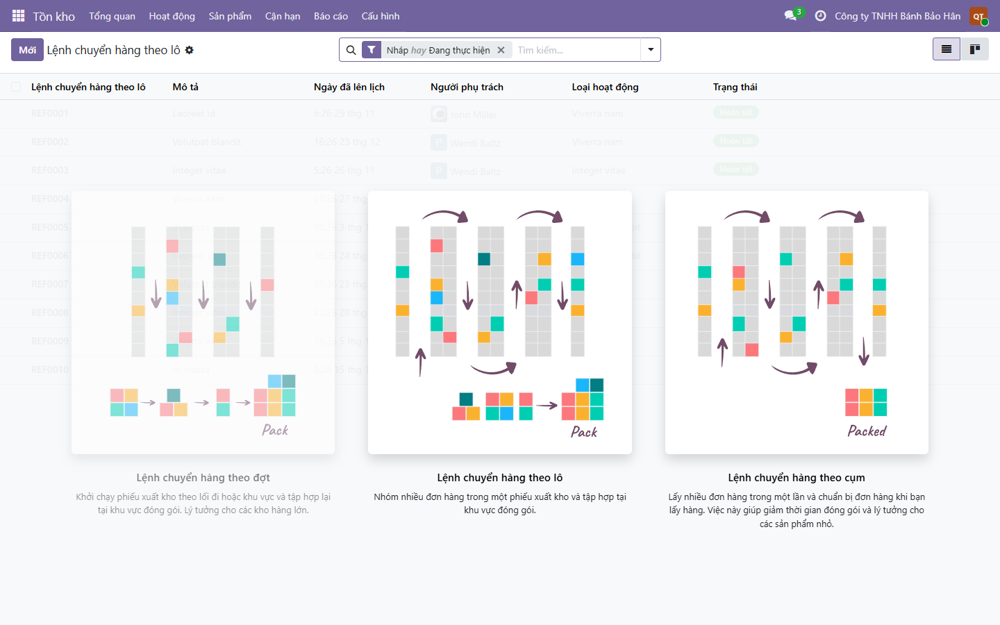

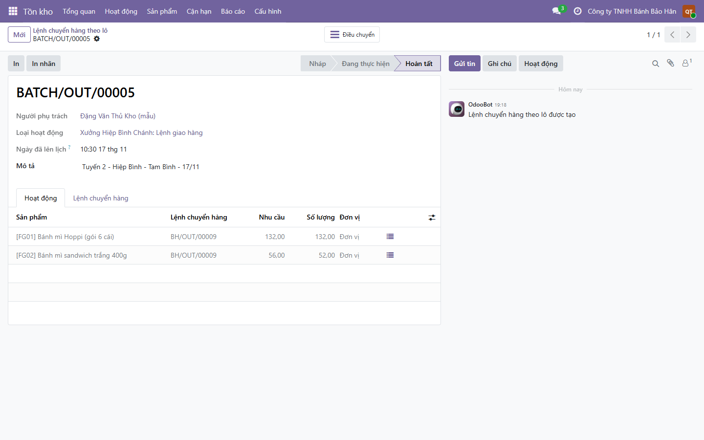

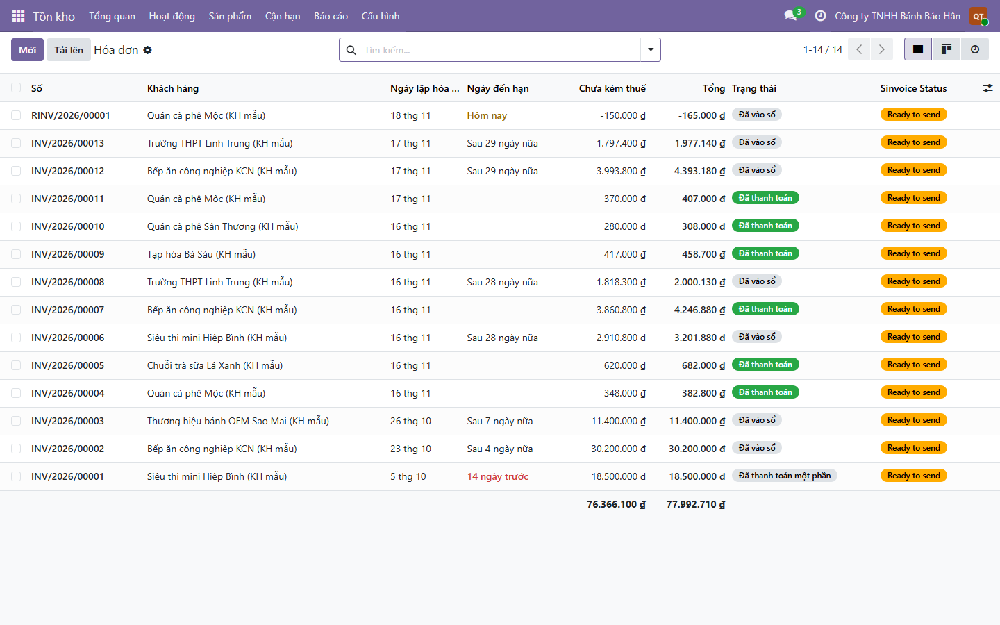

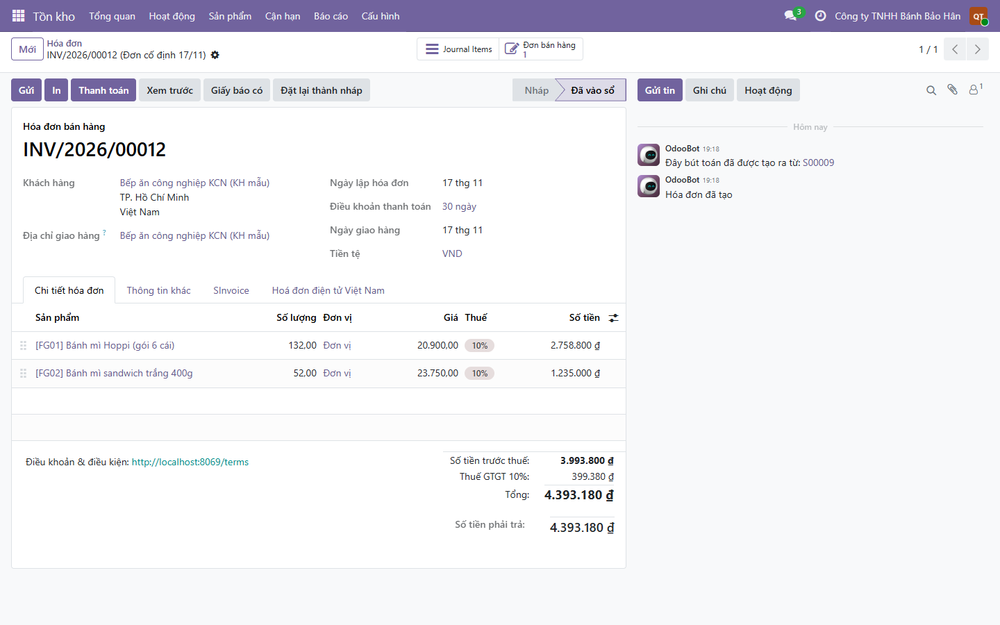

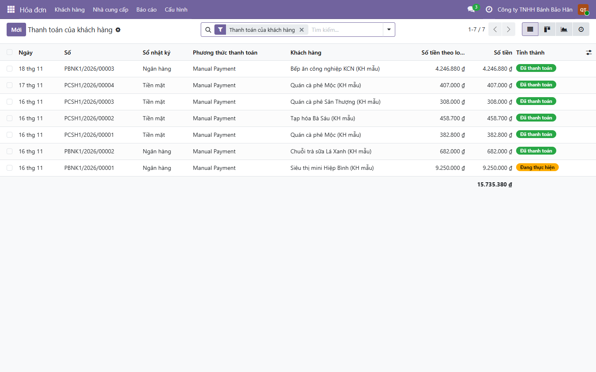

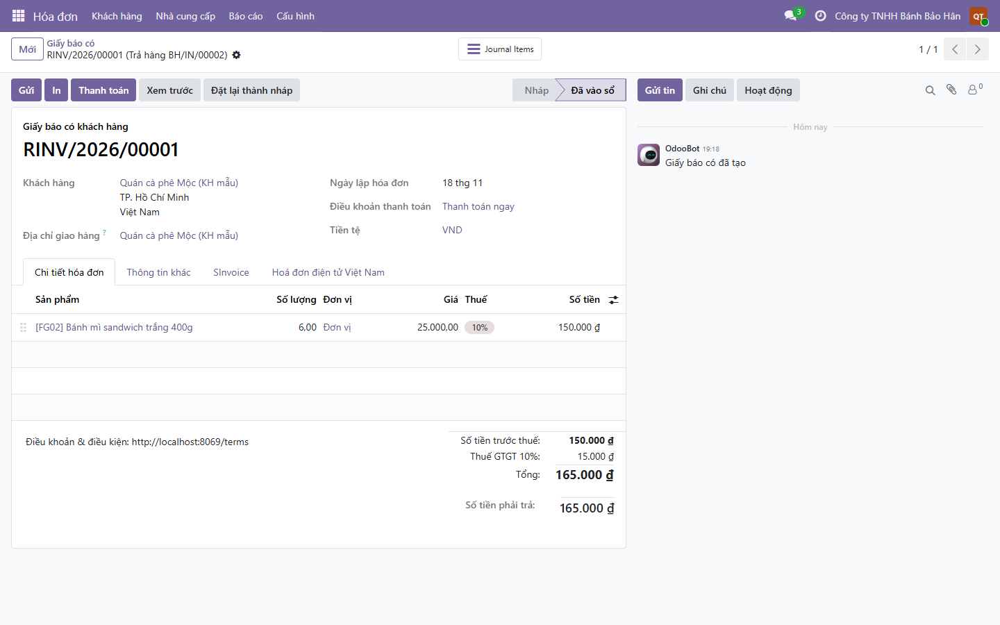

### 5.1.5. Ngoại lệ

| Tình huống (có trong dữ liệu) | Cách hệ thống xử lý |
|---|---|
| KH03 có hóa đơn tháng 10 quá hạn (S00003, S00020) | BH2b chặn xác nhận; BH2a giao việc giám đốc; mở bằng nhãn duyệt |
| KH07 đóng cửa thứ Ba (S00011) | Hủy phiếu giao và đơn, ghi lý do; hàng chưa rời kho về sổ sách |
| Hết bánh khi soạn tới điểm cuối tuyến 3 (S00012) | Hủy, kinh doanh báo khách; bánh tươi không giao bù |
| KH04 nhận thiếu bánh mì do mẻ thiếu | Hóa đơn chỉ tính số đã giao |
| KH01 trả 6 ổ không bán hết | Phiếu trả vào Khu cách ly + giấy báo có |
| Khách chuyển khoản sai nội dung | Webhook đánh dấu "Không khớp", kế toán đối soát tay |

### 5.1.6. Báo cáo

Người dùng: đơn ngày mai theo tuyến, đơn cần lập hóa đơn. Quản lý: phân tích bán hàng theo khách, sản phẩm, nhân viên, ngày; tỷ lệ hàng trả theo khách; khách đang bị chặn.

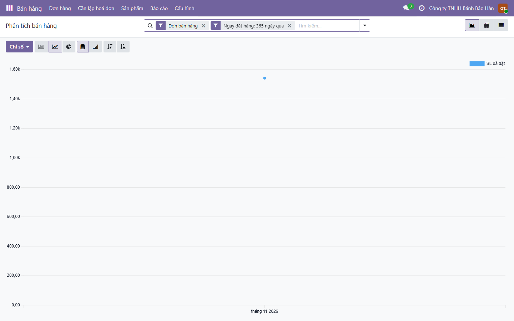

## 5.2. QT2 – Đặt nguyên liệu, kiểm tại cửa, nhận hàng, trả tiền (Procure to Pay)

### 5.2.1. Mục tiêu và phạm vi

Không thiếu nguyên liệu cho ca đêm, không tồn quá nhiều hàng mát hạn ngắn, mua đúng giá đã chốt, chỉ nhận hàng đạt chất lượng và chỉ trả tiền cho số đã nhận.

Bối cảnh: 6 nhà cung cấp cố định. Hàng mát (trứng, sữa, bơ, kem) giao 2–3 lần/tuần; hàng khô (bột, đường) đặt mỗi tuần. Giá chốt theo quý. Nhà cung cấp trứng nhận tiền mặt khi giao; nhà cung cấp lớn trả sau 30 ngày.

### 5.2.2. Mô hình BPMN

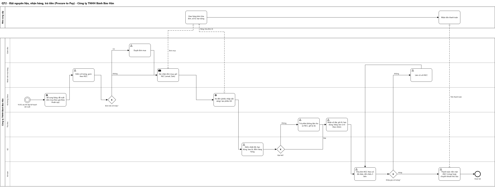

### 5.2.3. Đặc tả quy trình

| # | Bước | Người thực hiện | Mô tả | Màn hình / chứng từ Odoo |
|---|---|---|---|---|
| 0 | Chốt giá quý | Giám đốc, NV mua | Thỏa thuận giá và số lượng dự kiến cả quý với NCC chính | Mua hàng > Hợp đồng mua hàng (Blanket Order) |
| 1 | Xác định nhu cầu | Hệ thống, 16:30 | Sau khi quản đốc lập kế hoạch: NVL dưới mức tối thiểu hoặc không đủ cho lệnh sản xuất | Tồn kho > Bổ sung hàng |
| 2 | Tạo đơn mua | NV mua | Bấm Đặt hàng → đơn mua nháp gom theo NCC, giá lấy từ hợp đồng; kiểm số lượng | Đơn mua (nháp) |
| 3 | Xác nhận, gửi NCC | NV mua | Xác nhận; gửi PDF qua email/Zalo; hẹn ngày giao | Đơn mua đã đặt |
| 4 | Duyệt đơn lớn | Giám đốc | Đơn trên 20 triệu chuyển "Chờ duyệt"; giám đốc phê duyệt | Đơn mua chờ duyệt → đã đặt |
| 5 | Chuẩn bị kiểm hàng | Hệ thống | BH1: khi đơn mua xác nhận, tạo sẵn phiếu QC cho từng NVL, giao việc QC hạn đúng ngày xe đến | Phiếu QC (sẵn sàng) |
| 6 | Kiểm tại cửa | QC + thủ kho, 07:00 | Đo nhiệt độ hàng mát (0–5 °C), kiểm bao bì, hạn dùng, đếm hàng hỏng | Phiếu QC đạt / không đạt |
| 7 | Nhận hàng | Thủ kho | Nhận số đạt, nhập số lô và hạn dùng in trên bao; hàng không đạt trả lại xe NCC, không tạo đơn chờ | Phiếu nhập done, ghi chú lý do |
| 8 | Cất hàng | Hệ thống | Quy tắc cất hàng đưa vào Kho mát / Kho khô / Kho bao bì | – |
| 9 | Đối chiếu 3 bên | Kế toán | Hóa đơn NCC lấy số lượng theo số đã nhận; so đơn mua – phiếu nhập – hóa đơn giấy; lệch thì không xác nhận | Hóa đơn NCC |
| 10 | Thanh toán | Kế toán | NCC trứng: tiền mặt khi nhận; NCC khác: chuyển khoản thứ Sáu theo hạn | Thanh toán NCC |
| 11 | Trả hàng phát hiện sau | Thủ kho, kế toán | Lỗi ẩn (bơ hỏng) → phiếu trả NCC, giấy báo có NCC | Phiếu trả, hóa đơn điều chỉnh |

### 5.2.4. Cấu hình phục vụ quy trình

| Cấu hình | Giá trị | Ý nghĩa kiểm soát |
|---|---|---|
| Hợp đồng mua hàng (purchase_requisition) | 3 hợp đồng quý: NCC01 bột, đường, dầu, ngũ cốc; NCC03 bơ, sữa, kem; NCC04 trứng | Chỉ mua theo giá đã chốt |
| Bảng giá NCC trên sản phẩm | Giá, thời gian giao (1–5 ngày) | Đề xuất mua tự điền giá, ngày |
| Quy tắc tái đặt hàng NVL | Min/max theo mức dùng (ví dụ trứng 1.000–3.000 quả) | Không thiếu, không tồn nhiều |
| Duyệt đơn mua 2 cấp | Ngưỡng 20.000.000 VND | Giám đốc kiểm soát đơn lớn |
| Kiểm soát hóa đơn | Theo số đã nhận | Không trả tiền cho hàng chưa nhận |
| Điều khoản thanh toán NCC | Trứng: trả ngay; khác: 30 ngày | Lịch trả tiền đúng thỏa thuận |
| Phiếu kiểm tra (OCA) | "Kiểm nguyên liệu mát đầu vào", "Kiểm nguyên liệu khô đầu vào" | Lưu hồ sơ kiểm tra theo HACCP |
| Automation BH1 | Đơn mua xác nhận → phiếu QC + việc cho QC | Không quên kiểm hàng |

### 5.2.5. Minh họa trên hệ thống

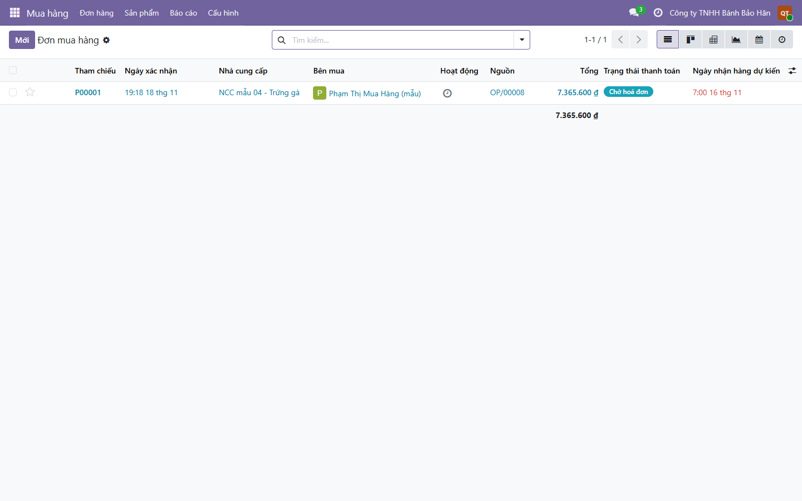

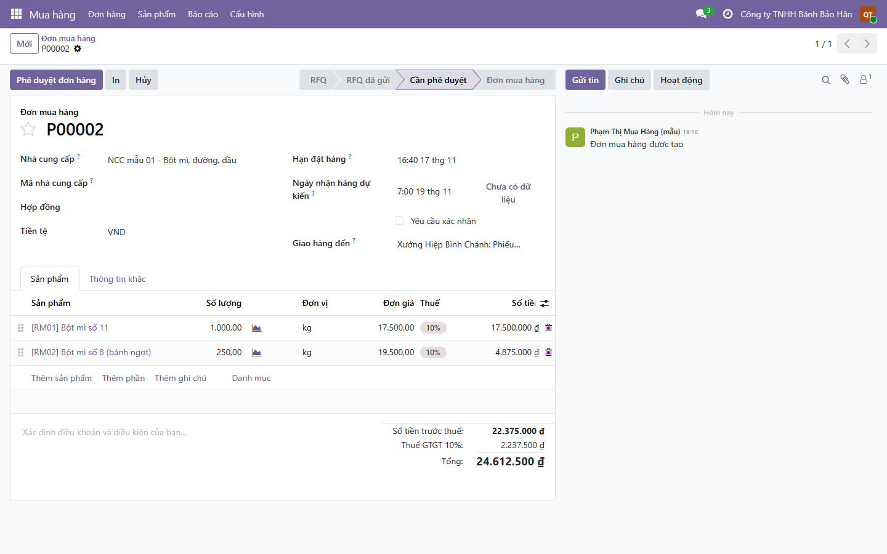

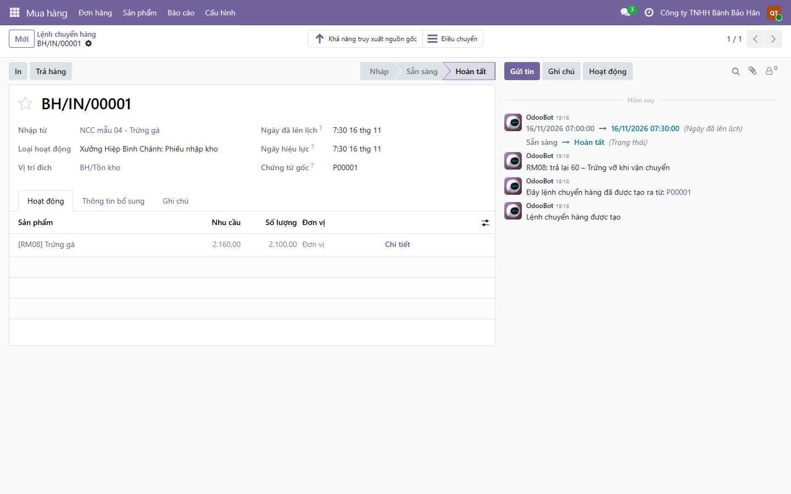

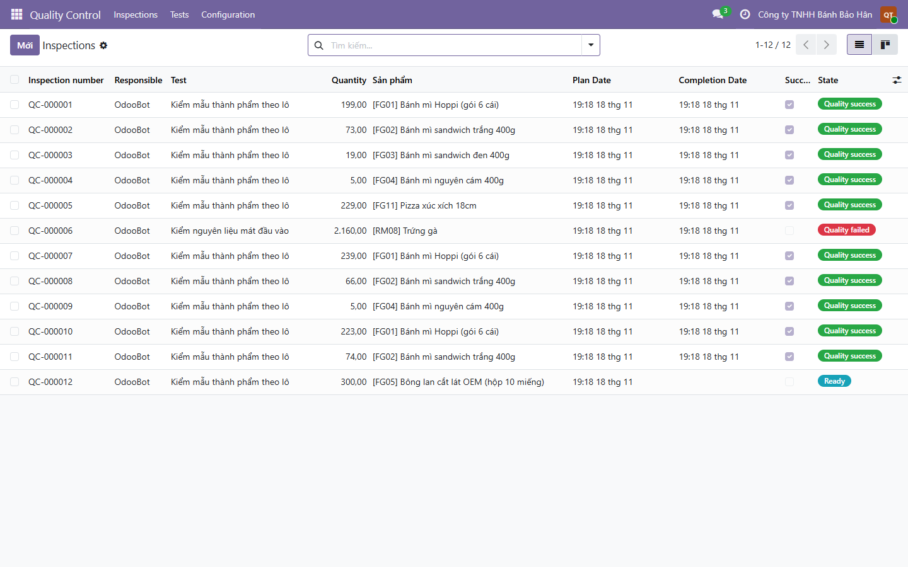

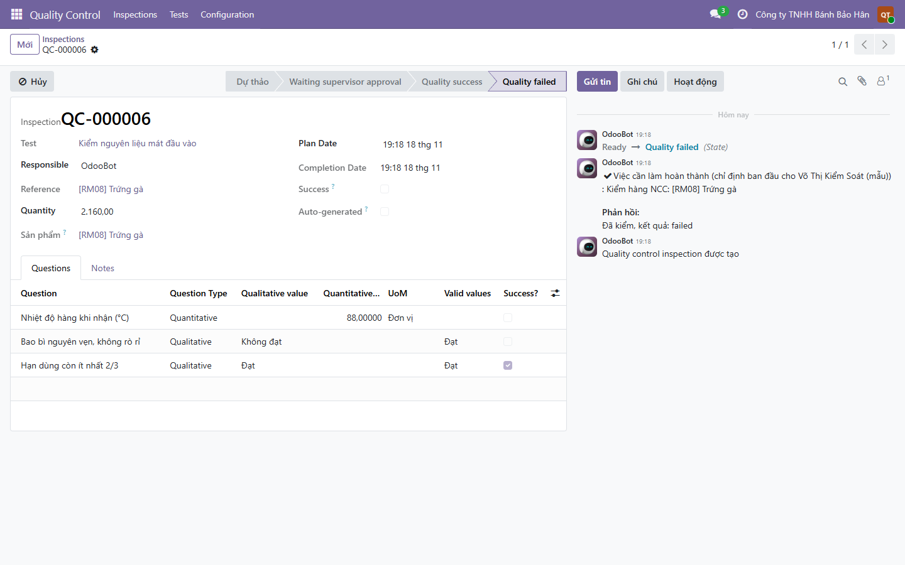

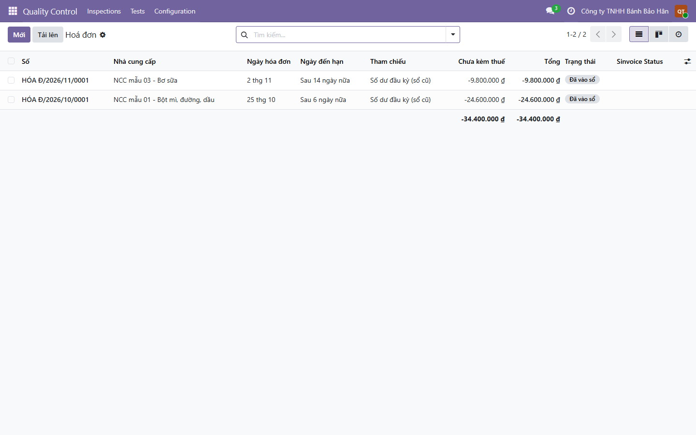

### 5.2.6. Ngoại lệ

| Tình huống | Cách xử lý |
|---|---|
| Trứng vỡ khi giao (thứ Hai, có trong dữ liệu) | QC không đạt; nhận thiếu 60 quả; không tạo đơn chờ; hóa đơn chỉ theo số nhận |
| Đơn lớn vượt ngưỡng (P00002) | Chờ giám đốc duyệt mới thành đơn đặt |
| NCC giao trễ làm thiếu NVL ca đêm | Quản đốc đổi thứ tự mẻ; kinh doanh báo khách |
| Giá NCC tăng giữa quý | Cập nhật hợp đồng, giám đốc duyệt; hóa đơn lệch giá không được xác nhận |
| Hàng mát quá nhiệt độ | Không nhận; phiếu QC ghi lý do để đánh giá NCC cuối quý |
| Phát hiện lỗi sau khi nhận | Phiếu trả NCC + giấy báo có NCC |

### 5.2.7. Báo cáo

Người dùng: đơn chờ giao hôm nay, đơn chờ hóa đơn, phiếu QC cần làm. Quản lý: giá trị mua theo NCC và tháng, biến động giá so hợp đồng, tỷ lệ không đạt theo NCC (lọc phiếu QC "Không đạt" nhóm theo sản phẩm/NCC), công nợ phải trả đến hạn (tuổi nợ OCA).

### 5.2.8. Bút toán

| Nghiệp vụ | Bút toán (dữ liệu thật) |
|---|---|
| Hóa đơn NCC trứng P00001 | Nợ 152 6.510.000; Nợ 1331 651.000 / Có 3311 7.161.000 |
| Thanh toán NCC | Nợ 3311 / Có tiền mặt hoặc ngân hàng |

## 5.3. QT3 – Sản xuất theo mẻ: Odoo cho quản đốc xưởng

### 5.3.1. Mục tiêu và nguyên tắc

Mỗi ngày làm đúng số bánh cần giao và cần dự trữ; mỗi lô có hạn dùng và kết quả kiểm mẫu; biết giá thành và hao hụt. Người dùng Odoo trên sàn sản xuất là **quản đốc** (và tổ trưởng ghi sản lượng cuối ca); thợ làm theo phiếu in. Bánh tươi làm theo tổng đơn ngày mai, hàng trữ (cookies, cấp đông) theo min/max, OEM làm theo đơn (MTO).

### 5.3.2. Mô hình BPMN

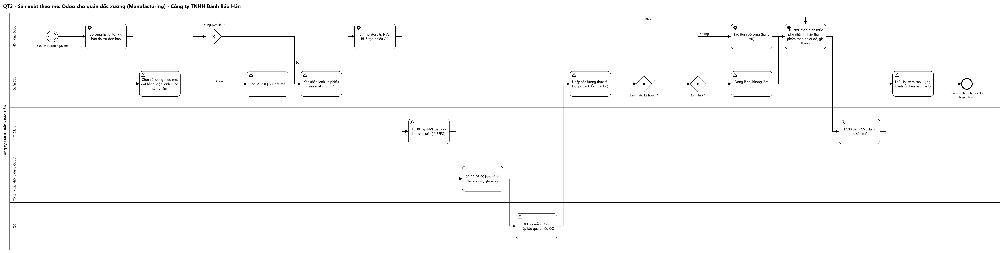

### 5.3.3. Đặc tả quy trình

| # | Giờ | Người | Việc | Màn hình Odoo |
|---|---|---|---|---|
| 1 | 16:00 | Quản đốc | Mở Bổ sung hàng: Odoo đề xuất số cần làm cho mọi sản phẩm có tồn dự báo âm | Tồn kho > Vận hành > Bổ sung hàng |
| 2 | 16:10 | Quản đốc | Chốt số lượng theo mẻ, Đặt hàng → lệnh sản xuất; gộp lệnh cùng sản phẩm | Lệnh sản xuất |
| 3 | 16:15 | Hệ thống | Kiểm nguyên liệu; thiếu → lệnh "Chờ", báo mua (QT2) | Cột trạng thái nguyên liệu |
| 4 | 16:20 | Quản đốc | Xác nhận lệnh, in phiếu sản xuất cho thợ; BH5 tạo phiếu kiểm mẫu | Lệnh đã xác nhận, phiếu QC |
| 5 | 16:30 | Thủ kho | Cấp NVL cả ca ra Khu sản xuất, lô FEFO | Phiếu cấp NVL |
| 6 | 22:00–05:00 | Thợ | Làm bánh theo phiếu | Không thao tác |
| 7 | 05:00 | QC | Lấy mẫu mỗi lô: nhiệt độ lõi, cảm quan, khối lượng, nhãn | Phiếu QC đạt / không đạt |
| 8 | 05:15 | Quản đốc / tổ trưởng | Nhập sản lượng thực tế, lô (mã SP-ngày); hạn dùng tự tính | Lệnh sản xuất |
| 9 | 05:20 | Quản đốc | Làm thiếu: bánh tươi đóng lệnh không làm bù; hàng trữ tạo lệnh bổ sung. Bánh lỗi → Loại bỏ | Hộp thoại làm thiếu; phiếu loại bỏ |
| 10 | 05:20 | Hệ thống | Trừ NVL theo định mức, ghi phụ phẩm, nhập thành phẩm theo nhiệt độ, tính giá thành | Tự động |
| 11 | 17:00 | Thủ kho | Đếm NVL dư ở Khu sản xuất, trả kho hoặc điều chỉnh hao hụt | Điều chỉnh tồn |
| 12 | Thứ Hai | Quản đốc | Xem sản lượng, bánh lỗi, tiêu hao, tải lò tuần trước | Pivot lệnh sản xuất, tải khu vực |

### 5.3.4. Minh họa trên hệ thống

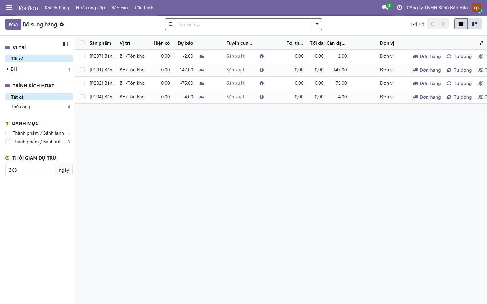

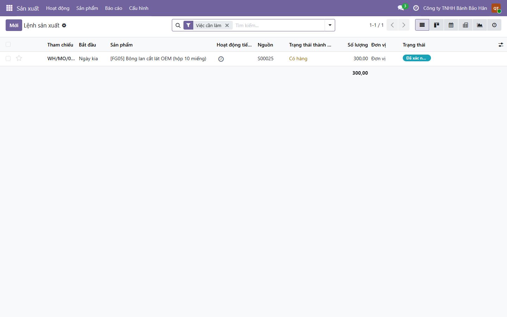

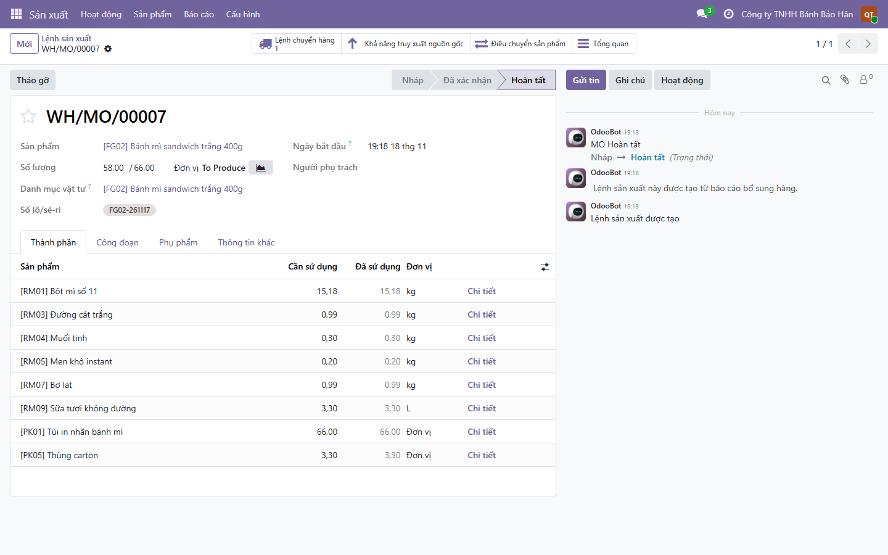

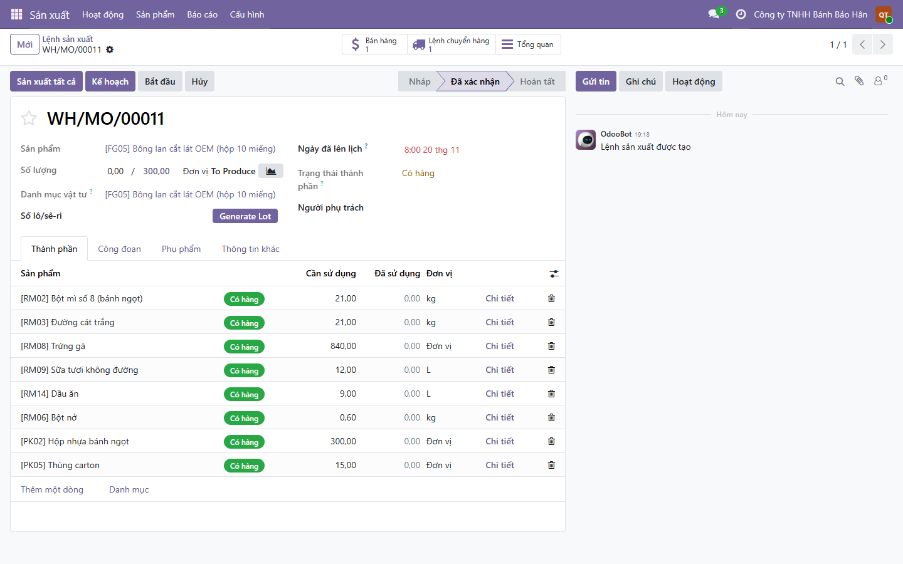

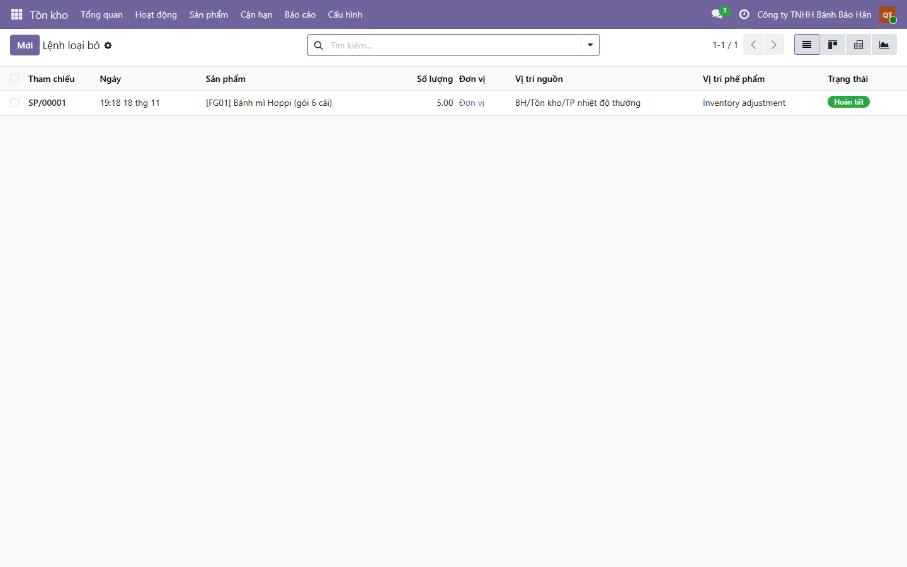

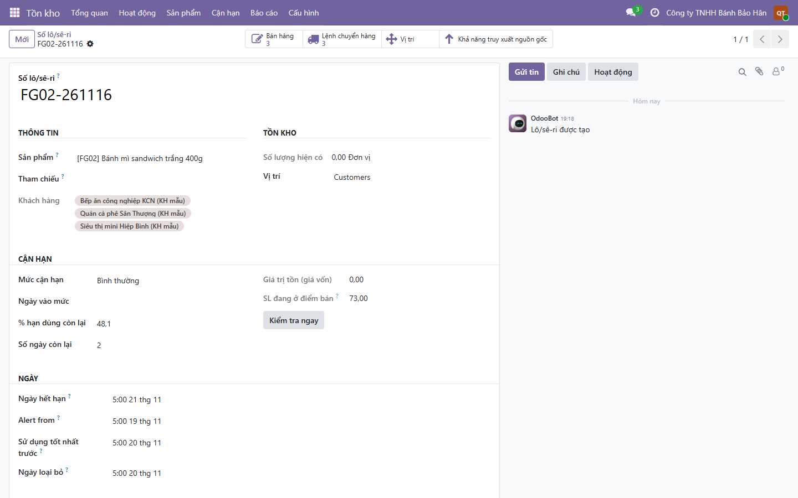

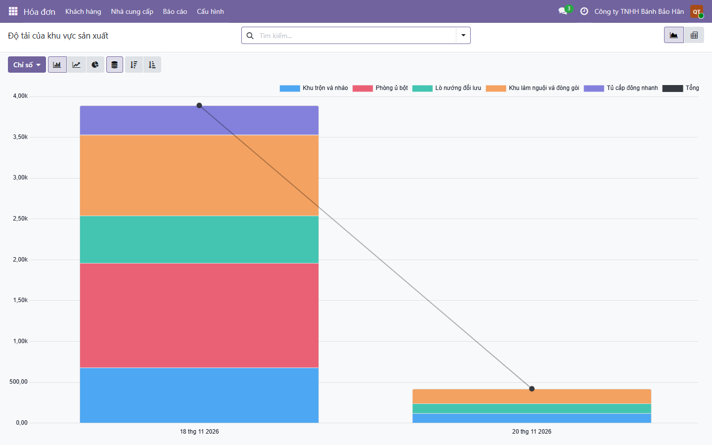

### 5.3.5. Ngoại lệ

| Tình huống | Cách xử lý |
|---|---|
| Mẻ bánh mì sandwich thiếu 8 ổ (WH/MO/00007) | Ghi số thực 58, đóng lệnh; bếp ăn nhận thiếu, hóa đơn theo số giao |
| 5 gói Hoppi rách khi đóng gói (SP/00001) | Phiếu loại bỏ gắn lệnh, có lý do |
| Thiếu NVL | Lệnh chờ; đề xuất mua; dời mẻ |
| Lò hỏng | Dời lệnh sang ca ngày, ghi chú |
| Lô thành phẩm không đạt QC | Loại bỏ cả lô, làm lại nếu kịp giờ giao |
| Làm dư | Vào tồn, module cận hạn theo dõi |

### 5.3.6. Giới hạn chấp nhận

Thời gian công đoạn ghi bằng định mức (thợ không bấm giờ), nên phần nhân công trong giá thành là giá thành định mức. Production Analysis và Shop Floor là tính năng Enterprise; bản Community dùng Pivot trên lệnh sản xuất và báo cáo tải khu vực.

## 5.4. QT4 – Lô, hạn dùng, cận hạn, cách ly, kiểm kê

### 5.4.1. Mục tiêu

Biết chính xác còn gì, ở đâu, lô nào, hết hạn khi nào; không giao lô quá hạn; thu hồi bánh cận hạn ở điểm bán; kiểm kê nhanh và giải thích được chênh lệch.

### 5.4.2. Mô hình BPMN

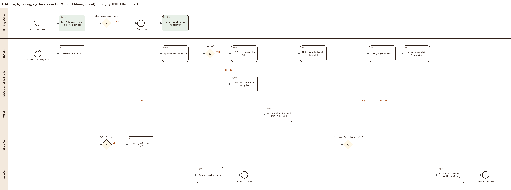

### 5.4.3. Đặc tả quy trình

| # | Nhịp | Người | Việc | Odoo |
|---|---|---|---|---|
| 1 | 23:00 hằng ngày | Hệ thống | Tính % hạn còn lại mọi lô ở kho và ở khách | Module bh_near_expiry |
| 2 | Sáng | Thủ kho | Xem việc cận hạn; lô ở điểm bán → in danh sách thu hồi cho tài xế | Việc cận hạn, lọc "Đang ở điểm bán" |
| 3 | Sáng | Kinh doanh | Cookies, cấp đông còn ≤ 30% → chào giá xả | Giá đề xuất trên việc |
| 4 | Khi phát hiện | Thủ kho | Lô cần thu hồi / hết hạn ở kho → chuyển Khu cách ly | Phiếu nội bộ BH/INT |
| 5 | Khi tài xế về | Thủ kho | Nhận hàng thu hồi vào Khu cách ly | Phiếu trả |
| 6 | Hằng tuần | Giám đốc, thủ kho | Duyệt hủy hoặc làm vụn bánh | Nút Hủy lô → phiếu hủy, ghi tổn thất |
| 7 | 17:00 hằng ngày | Thủ kho | Đếm nhanh thành phẩm | Điều chỉnh tồn |
| 8 | Thứ Bảy / cuối tháng | Thủ kho, giám đốc | Kiểm kê theo vị trí, lô; chênh lệch lớn giám đốc xem trước khi áp dụng | Điều chỉnh tồn |

Quy tắc cận hạn theo nhóm: bánh mì tươi thu hồi khi còn ≤ 40%; bánh lạnh ≤ 34%; bánh ngọt, cookies, cấp đông theo dõi 50% – giảm giá 30% – thu hồi 15%; NVL mát theo dõi 50% – cách ly 15%.

### 5.4.4. Minh họa trên hệ thống

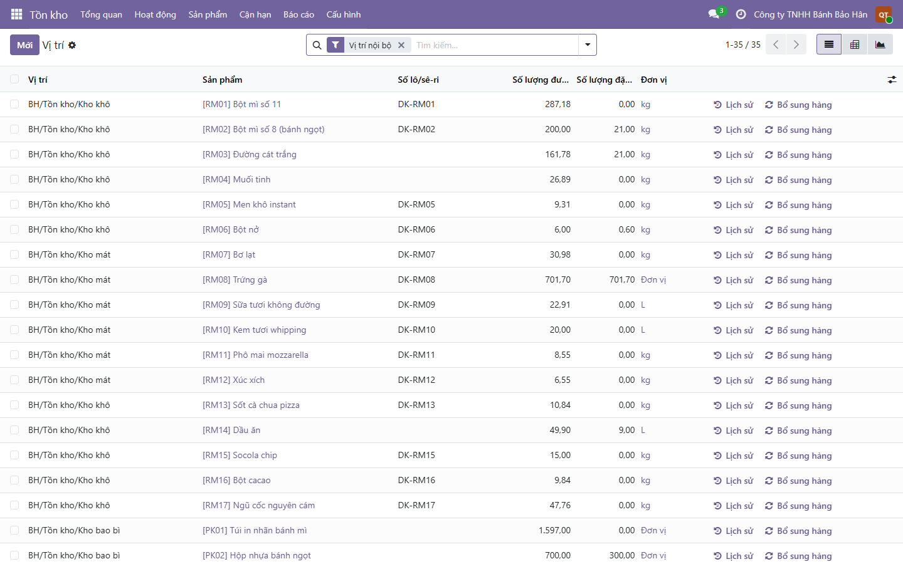

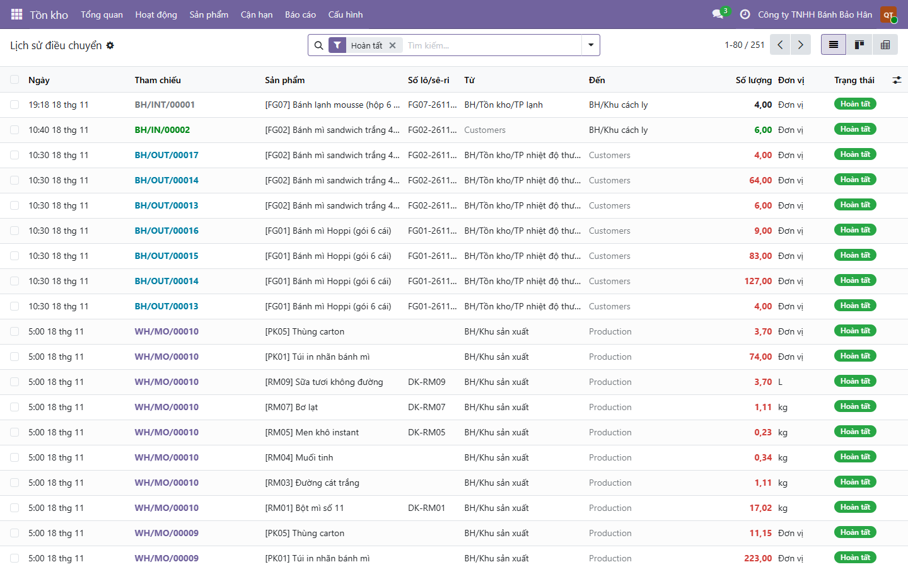

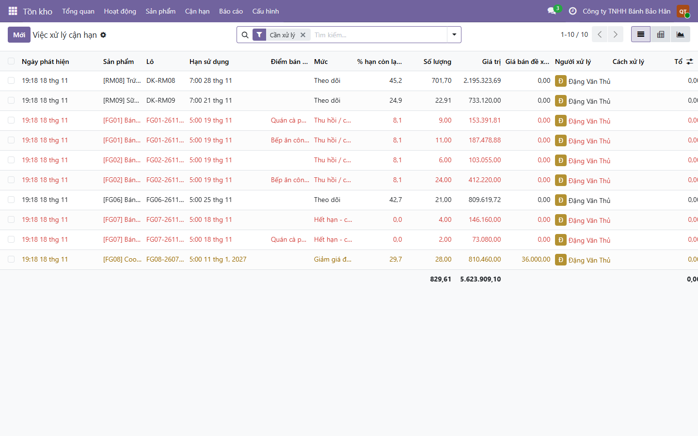

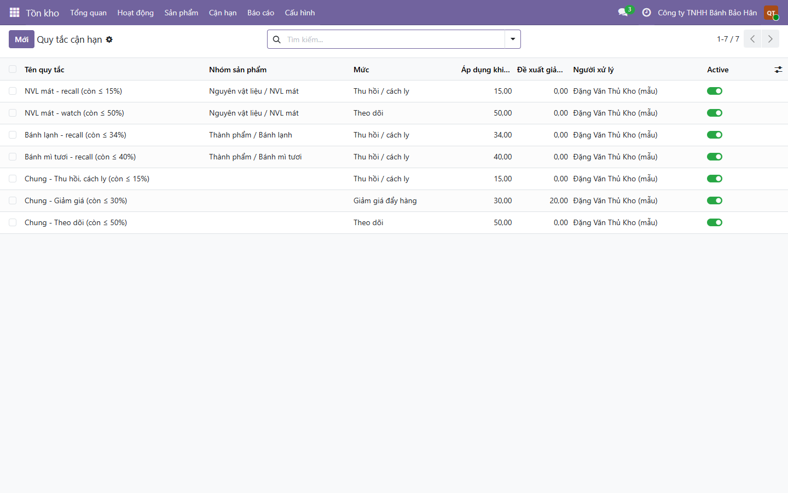

### 5.4.5. Ngoại lệ

Lô quá ngày rút khỏi kệ không được giữ cho đơn (Odoo); hàng trả về không rõ lô vào Khu cách ly để kiểm; chênh lệch kiểm kê phải có người duyệt (bánh tiệc trà thiếu 2 khay ngày 17/11 có trong dữ liệu).

## 5.5. QT5 – Công nợ, thu tiền, đối soát

### 5.5.1. Mục tiêu

Công nợ phải thu, phải trả đúng theo chứng từ; tiền về được ghi nhận ngay; khách nợ quá hạn bị chặn bán; số liệu cuối tháng khớp với phần mềm kế toán khai thuế.

### 5.5.2. Mô hình BPMN

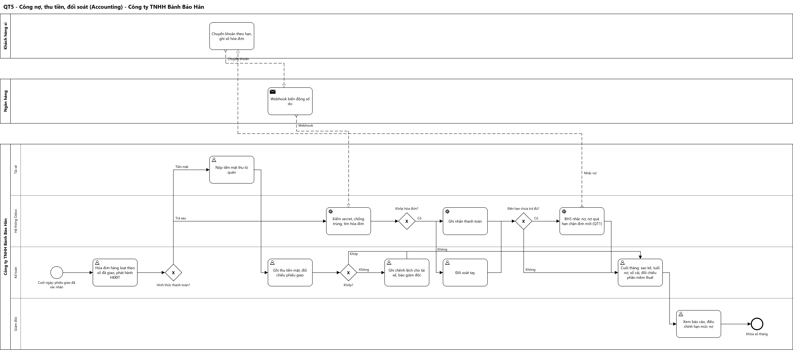

### 5.5.3. Đặc tả quy trình

| # | Nhịp | Người | Việc | Odoo |
|---|---|---|---|---|
| 1 | Go-live | Kế toán | Chuyển công nợ tháng 10 từ sổ cũ (đối ứng TK 4211) | Hóa đơn có tham chiếu "Số dư đầu kỳ" |
| 2 | Cuối ngày | Kế toán | Hóa đơn hàng loạt theo số đã giao, phát hành hóa đơn điện tử | Hóa đơn |
| 3 | Cuối ngày | Tài xế → Kế toán | Nộp tiền mặt; ghi thu, đối chiếu phiếu giao; chênh lệch ghi cho tài xế | Thanh toán tiền mặt |
| 4 | Liên tục | Ngân hàng → Hệ thống | Webhook: kiểm secret, chống trùng, tìm số hóa đơn trong nội dung, ghi nhận | Giao dịch ngân hàng |
| 5 | Khi có | Kế toán | Giao dịch không khớp → đối soát tay | |
| 6 | Hằng ngày | Hệ thống | BH3: hóa đơn quá hạn 1 ngày → việc nhắc nợ; nợ quá hạn → chặn đơn mới (BH2b) | Hoạt động |
| 7 | Thứ Sáu | Kế toán | Trả nhà cung cấp đến hạn | Thanh toán NCC |
| 8 | Cuối tháng | Kế toán, giám đốc | Sao kê công nợ, tuổi nợ, sổ cái, cân đối phát sinh; điều chỉnh hạn mức nợ | Báo cáo OCA |

### 5.5.4. Minh họa trên hệ thống

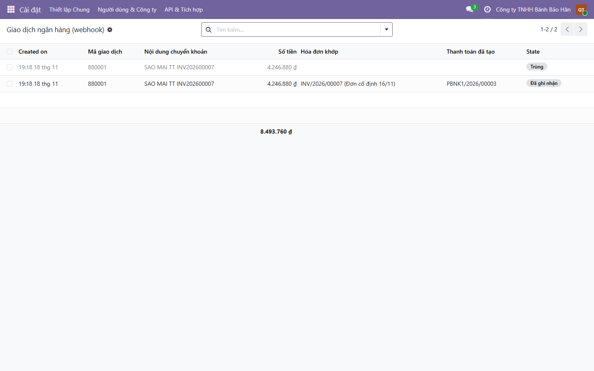

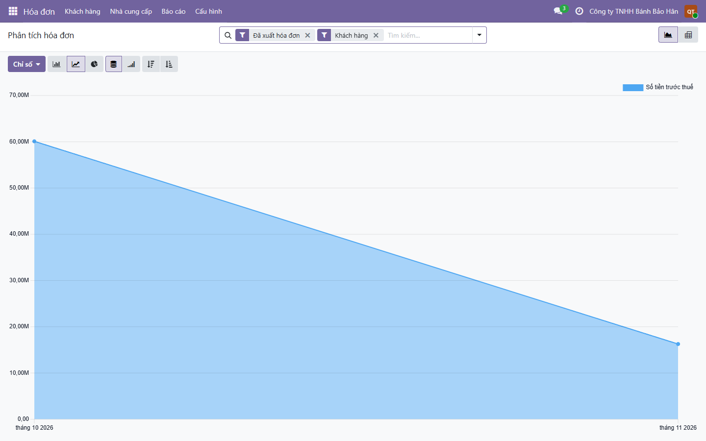

### 5.5.5. Bút toán tiêu biểu (dữ liệu thật)

| Chứng từ | Bút toán |
|---|---|
| Hóa đơn INV/2026/00012 (KH04) | Nợ 1311 4.393.180 / Có 511 3.993.800, Có 33311 399.380; Nợ 632 3.288.683 / Có 155 3.288.683 |
| Thanh toán qua webhook | Nợ 1131 (tiền đang chuyển) / Có 1311 |
| Giấy báo có RINV/2026/00001 (KH01 trả 6 ổ) | Nợ 511 150.000, Nợ 33311 15.000 / Có 1311 165.000; Nợ 155 / Có 632 103.055 |

Ghi chú: thanh toán ghi vào 1131 – tài khoản tiền đang chuyển; khi đối soát với sổ phụ ngân hàng sẽ chuyển sang tiền gửi ngân hàng (kiến thức từ video eLearning "Payments and outstanding accounts").
