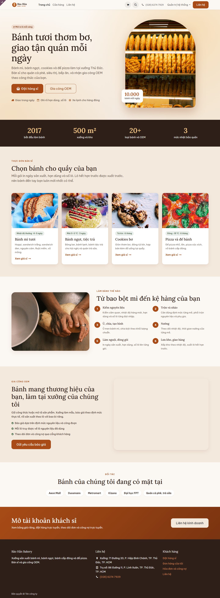
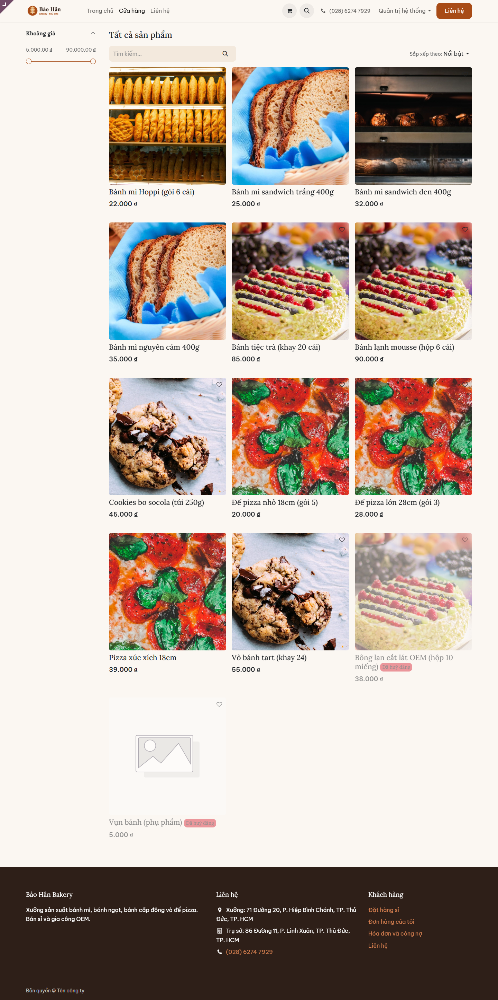
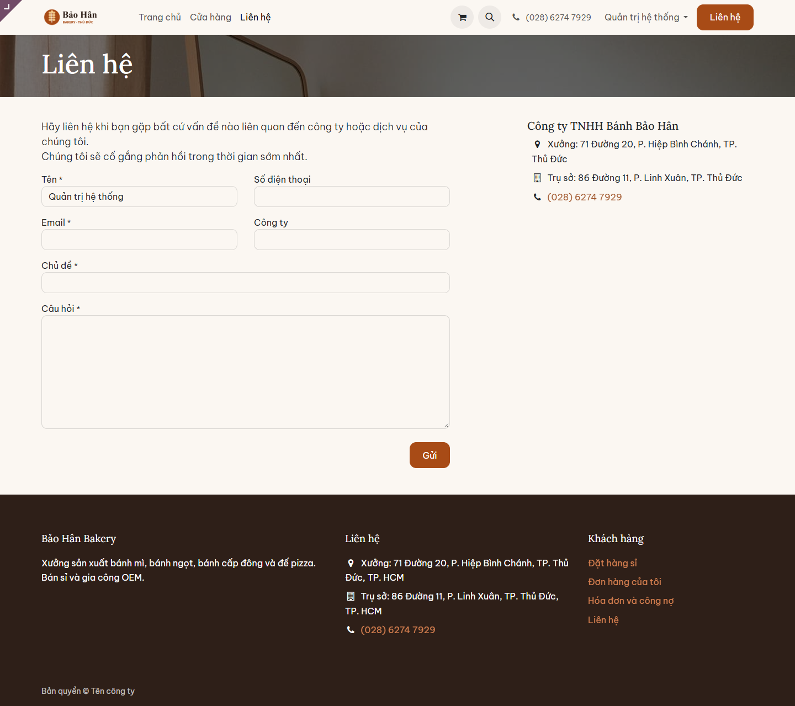
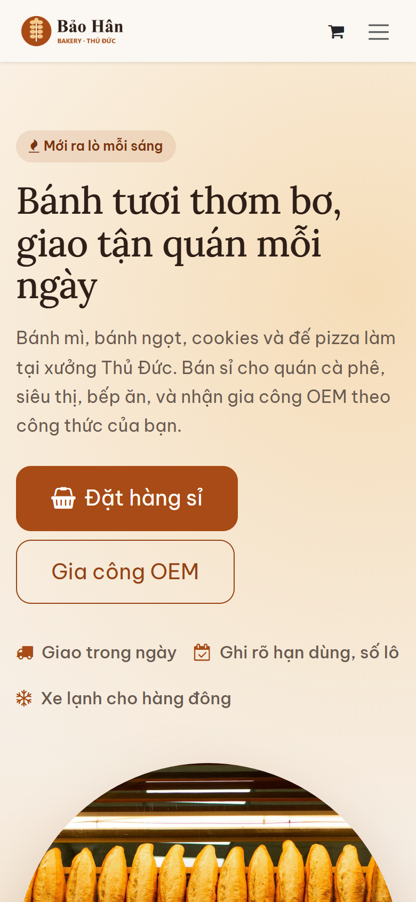

# CHƯƠNG 6. PHÂN TÍCH, THIẾT KẾ VÀ XÂY DỰNG WEBSITE

## 6.1. Mục tiêu

Website của Bảo Hân không phải cửa hàng bán lẻ mà là **kênh nhận đơn và chăm sóc khách sỉ**, nối thẳng vào Odoo:

1. Giới thiệu xưởng và sản phẩm để tìm khách sỉ, khách OEM mới.
2. Cho khách sỉ xem giá theo bảng giá riêng và đặt hàng không cần gọi điện.
3. Cho khách tự xem đơn hàng, hóa đơn, công nợ (cổng khách hàng), giảm cuộc gọi hỏi nợ.
4. Thu yêu cầu báo giá OEM vào Odoo (form liên hệ → cơ hội CRM).

## 6.2. Đối tượng người dùng

| Nhóm | Nhu cầu | Thiết bị |
|---|---|---|
| Chủ quán cà phê, tạp hóa | Xem sản phẩm, giá sỉ, đặt nhanh cho ngày mai | Điện thoại |
| Bộ phận mua của siêu thị, bếp ăn, trường học | Xem hóa đơn, công nợ, tải hóa đơn | Máy tính |
| Thương hiệu tìm xưởng OEM | Năng lực xưởng, quy trình, gửi yêu cầu báo giá | Máy tính |
| Nhân viên kinh doanh Bảo Hân | Nhận đơn và yêu cầu ngay trong Odoo | Odoo |

## 6.3. Yêu cầu

### 6.3.1. Yêu cầu chức năng

| Mã | Yêu cầu | Đáp ứng bằng |
|---|---|---|
| F1 | Trang chủ giới thiệu xưởng, nhóm sản phẩm, quy trình, OEM, đối tác | Theme (homepage QWeb) |
| F2 | Danh mục sản phẩm có ảnh, giá theo bảng giá của khách đăng nhập | eCommerce (website_sale) + pricelist của khách |
| F3 | Giỏ hàng, đặt hàng → đơn bán trong Odoo | eCommerce |
| F4 | Cổng khách hàng: đơn hàng, hóa đơn, công nợ | Portal của Odoo |
| F5 | Form liên hệ / yêu cầu báo giá OEM | Trang Liên hệ (form → Odoo) |
| F6 | Thông tin liên hệ thật (hotline, địa chỉ xưởng, trụ sở) | Header, footer, trang Liên hệ trong theme |
| F7 | Nhân viên sửa nội dung, ảnh không cần lập trình | Snippet chuẩn trong oe_structure (Website Builder) |

### 6.3.2. Yêu cầu phi chức năng

| Mã | Yêu cầu | Tiêu chí |
|---|---|---|
| N1 | Thẩm mỹ, đúng ngành bánh | Tông ấm, ảnh bánh thật, cảm giác "mới ra lò" |
| N2 | Dễ đọc tiếng Việt | Font hỗ trợ đủ dấu: Be Vietnam Pro (nội dung), Lora (tiêu đề) |
| N3 | Khả năng tiếp cận | Tương phản chữ/nền đạt WCAG AA (≥ 4,5:1); viền focus khi dùng bàn phím; tôn trọng "giảm chuyển động" |
| N4 | Hiển thị tốt trên điện thoại | Bố cục Bootstrap 5 co giãn; kiểm ở 375 px không tràn ngang |
| N5 | Không phá giao diện quản trị | CSS chỉ nằm dưới tiền tố `.x_custom_` |
| N6 | Không thư viện ngoài | Không Tailwind, React; chỉ SCSS + QWeb + Bootstrap 5 của Odoo |

## 6.4. Use case chính

| Use case | Tác nhân | Luồng chính |
|---|---|---|
| UC1 Xem sản phẩm | Khách | Trang chủ → nhóm sản phẩm → Cửa hàng → chi tiết |
| UC2 Đặt hàng sỉ | Khách sỉ đã có tài khoản | Đăng nhập → Cửa hàng (giá theo bảng giá riêng) → giỏ hàng → xác nhận → đơn bán trong Odoo (kinh doanh kiểm và xác nhận, BH2a/BH2b vẫn áp dụng) |
| UC3 Xem công nợ | Khách sỉ | Đăng nhập → Tài khoản của tôi → Hóa đơn → tải PDF |
| UC4 Yêu cầu OEM | Thương hiệu mới | Trang chủ (khối OEM) → Liên hệ → gửi form → kinh doanh nhận trong Odoo |
| UC5 Cập nhật nội dung | Nhân viên | Chế độ chỉnh sửa website → sửa chữ, thay ảnh trong khối |

## 6.5. Sơ đồ trang và luồng đặt hàng

| Trang | Đường dẫn | Nội dung |
|---|---|---|
| Trang chủ | / | Hero, số liệu, 4 nhóm sản phẩm, quy trình làm bánh, OEM, đối tác, kêu gọi mở tài khoản sỉ |
| Cửa hàng | /shop | 11 sản phẩm có ảnh, giá VND |
| Chi tiết sản phẩm | /shop/<sản phẩm> | Mô tả, hạn dùng, đặt hàng |
| Giỏ hàng, thanh toán | /shop/cart, /shop/checkout | Đặt hàng |
| Liên hệ | /contactus | Form, hotline, địa chỉ xưởng và trụ sở |
| Tài khoản khách | /my, /my/orders, /my/invoices | Đơn, hóa đơn, công nợ |

Luồng đặt hàng sỉ: Trang chủ → "Đặt hàng sỉ" → Cửa hàng → thêm sản phẩm → Giỏ hàng → Xác nhận → Odoo tạo đơn bán (nháp hoặc đã xác nhận tùy cấu hình) → kinh doanh kiểm công nợ, ngày giao → đơn vào kế hoạch sản xuất 16:00 như đơn nhận qua điện thoại.

## 6.6. Thiết kế giao diện

### 6.6.1. Khung bố cục trang chủ (wireframe)

| Khối | Bố cục | Mục đích |
|---|---|---|
| Header | Logo trái, menu giữa, hotline + nút "Liên hệ" phải | Nhận diện, gọi điện nhanh |
| 1. Hero | Chữ trái (nhãn "Mới ra lò mỗi sáng", tiêu đề, mô tả, 2 nút, 3 cam kết), ảnh kệ bánh phải trong khung vòm như cửa lò, thẻ nổi "10.000 bánh mỗi ngày" | Ấn tượng đầu tiên, kêu gọi đặt hàng |
| 2. Số liệu | 4 cột: năm bắt đầu, diện tích xưởng, số loại bánh, mức nhiệt bảo quản (thông tin công khai) | Tạo tin cậy |
| 3. Sản phẩm | 4 thẻ có ảnh 4:3, nhãn bảo quản và hạn dùng, liên kết giá sỉ | Dẫn sang cửa hàng |
| 4. Quy trình | Ảnh nhào bột trái, 6 bước phải | Thể hiện năng lực sản xuất |
| 5. OEM | Chữ trái, ảnh lò nướng phải, 3 cam kết, nút gửi yêu cầu | Tìm khách OEM |
| 6. Đối tác | Các thẻ tên khách hàng tiêu biểu (công khai) | Tin cậy |
| 7. Kêu gọi | Nền caramel, nút "Liên hệ kinh doanh" | Chuyển đổi |
| Footer | Giới thiệu, liên hệ (xưởng, trụ sở, hotline), liên kết khách hàng | Thông tin |

### 6.6.2. Design system

| Thành phần | Giá trị | Ghi chú |
|---|---|---|
| Màu nền chính (60%) | Kem #FBF7F2 | o-color-4 |
| Màu phụ (30%) | Lúa mì #F3E9DD, socola #2E1F18 | o-color-3, o-color-5 |
| Màu nhấn CTA (10%) | Caramel #A84B16 | o-color-1 |
| Màu chất lượng | Xanh lá xám #4F7350 | o-color-2, nhãn bảo quản |
| Font nội dung | Be Vietnam Pro | Đủ dấu tiếng Việt |
| Font tiêu đề | Lora | Gợi cảm giác thủ công, ấm |
| Cỡ tiêu đề | clamp(2.2rem, 1.3rem + 3.4vw, 3.8rem) | Co giãn theo màn hình |
| Giãn dòng nội dung | 1,65 | Dễ đọc |
| Bo góc | Thẻ 16 px, ảnh nổi bật 24 px, nút 0,75 rem | Mềm mại |
| Đổ bóng | Bóng nâu nhạt, đậm hơn khi rê chuột | Không dùng viền đen gắt |

Tương phản đã đo (WCAG AA yêu cầu ≥ 4,5:1 với chữ thường):

| Cặp chữ / nền | Tỷ lệ |
|---|---|
| Socola trên kem | 14,86 : 1 |
| Trắng trên caramel | 5,70 : 1 |
| Caramel trên kem | 5,35 : 1 |
| Chữ phụ #6B5A50 trên lúa mì | 5,47 : 1 |
| Vàng bơ trên socola (số liệu) | 10,18 : 1 |
| Chữ nhãn xanh trên nền nhãn | 6,38 : 1 |

### 6.6.3. Ảnh

7 ảnh bánh từ Pexels, Unsplash (giấy phép cho phép dùng thương mại), cắt về tỷ lệ 4:3 cho thẻ và 4:5 cho hero, nén JPEG chất lượng 82, xóa EXIF; nguồn ghi trong `static/src/img/CREDITS.md`. Đây là ảnh minh họa; khi triển khai thật thay bằng ảnh tự chụp tại xưởng qua Website Builder. Logo là logo chữ do nhóm tự vẽ, không sao chép logo thật.

## 6.7. Kiến trúc kỹ thuật (module theme_custom_website)

| Tệp | Vai trò |
|---|---|
| `__manifest__.py` | Khai báo theme, phụ thuộc `website`, tài nguyên (assets) |
| `static/src/scss/primary_variables.scss` | Ghi đè bảng màu (`$o-color-palettes`), font (`$o-theme-font-configs`), bo góc nút (`$o-website-values-palettes`); nạp vào `web._assets_primary_variables` |
| `static/src/scss/custom.scss` | Style riêng dưới tiền tố `.x_custom_`; nạp vào `web.assets_frontend` |
| `views/homepage.xml` | Kế thừa `website.homepage`, thay khối `#wrap` bằng 7 snippet chuẩn (`s_text_image`, `s_numbers`, `s_three_columns`, `s_call_to_action`…) trong `oe_structure` |
| `views/layout.xml` | Kế thừa footer, phần tử hotline của header, khối thông tin trang Liên hệ |
| `static/src/img/` | Ảnh, logo, nguồn ảnh |

Lưu ý kỹ thuật gặp khi làm: trình biên dịch SCSS của Odoo (libsass) không tính được `clamp()` trộn đơn vị rem và vw, nên phải bọc bằng `unquote()`; giá trị bo góc nút phải dùng rem vì Bootstrap tính toán với rem.

## 6.8. Kiểm thử website

| Kiểm thử | Kết quả |
|---|---|
| Biên dịch SCSS | Không lỗi (kiểm bundle CSS không có thông báo lỗi) |
| Hiển thị máy tính 1280–1440 px | Đúng bố cục |
| Hiển thị điện thoại 375–390 px | Không tràn ngang (chiều rộng trang bằng chiều rộng màn hình) |
| Số điện thoại, địa chỉ mẫu của Odoo | Đã thay toàn bộ ở trang chủ, cửa hàng, liên hệ |
| Ảnh sản phẩm trong cửa hàng | Đủ ảnh, giá VND |
| Tương phản | Đạt WCAG AA cho mọi cặp đã dùng |

## 6.9. Hạn chế và hướng phát triển

Website chạy trên máy local, chưa đưa lên Internet (không đưa dưới tên Bảo Hân khi doanh nghiệp chưa đồng ý). Muốn đưa lên: thuê VPS hoặc Odoo.sh, gắn tên miền, chứng chỉ HTTPS, bật cổng khách hàng có đăng ký mở tài khoản sỉ được duyệt.
