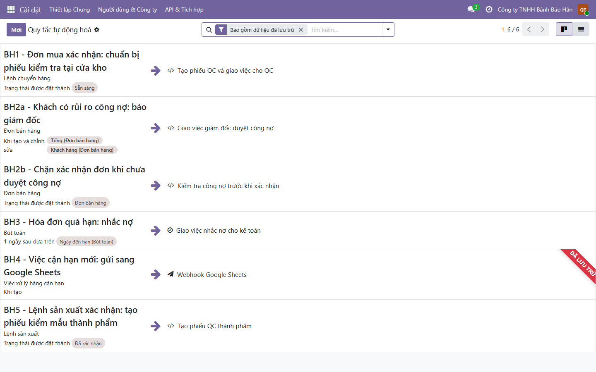
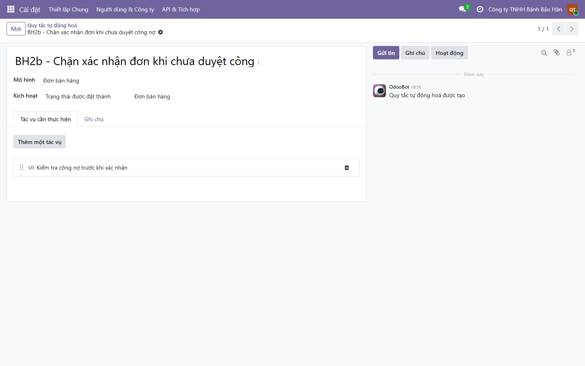
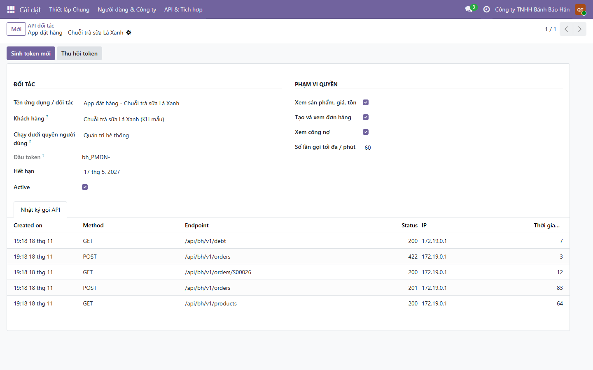
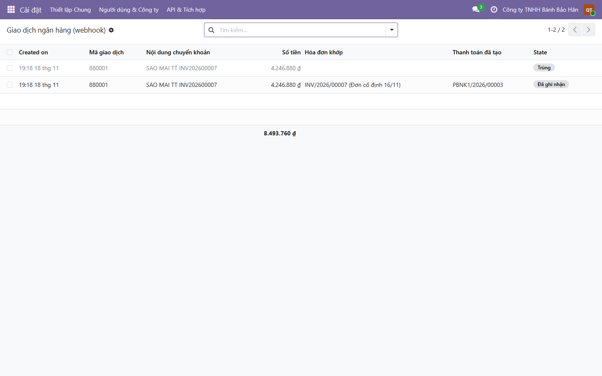

# CHƯƠNG 7. TỰ ĐỘNG HÓA, MODULE MỚI, API VÀ TÍCH HỢP

## 7.1. Tự động hóa quy trình bằng Automation Rules

### 7.1.1. Danh sách quy tắc

| Mã | Mô hình | Kích hoạt | Điều kiện | Hành động | Quy trình |
|---|---|---|---|---|---|
| BH1 | Phiếu kho | Trạng thái chuyển "Sẵn sàng" | Phiếu nhập hàng | Chạy code: tạo phiếu QC cho từng NVL theo nhóm (mát/khô), giao việc cho QC hạn đúng ngày xe đến; chống tạo trùng | QT2 |
| BH2a | Đơn bán | Tạo / sửa khách hoặc tổng tiền | Đơn nháp, khách nợ quá hạn hoặc vượt hạn mức, chưa có nhãn duyệt | Chạy code: giao việc "Duyệt công nợ" cho giám đốc, ghi rõ lý do | QT1 |
| BH2b | Đơn bán | Trạng thái chuyển "Đơn bán" | Như trên | Chạy code: báo lỗi, chặn xác nhận | QT1 |
| BH3 | Hóa đơn | Theo thời gian: 1 ngày sau hạn thanh toán | Hóa đơn bán chưa trả đủ | Giao việc "Gọi nhắc nợ" cho kế toán | QT5 |
| BH4 | Việc cận hạn | Khi tạo | – | Gửi webhook (JSON) sang Google Apps Script → Google Sheets | QT4 |
| BH5 | Lệnh sản xuất | Trạng thái chuyển "Đã xác nhận" | – | Chạy code: tạo phiếu kiểm mẫu thành phẩm theo lô, giao việc cho QC | QT3 |

Quy trình chính được tự động hóa là **kiểm soát công nợ khi bán hàng** (BH2a + BH2b): trước đây giám đốc phải nhớ khách nào nợ lâu; nay hệ thống tự chặn và đưa việc đến đúng người.





### 7.1.2. Đoạn code của BH2b

```
for order in records:
    reasons = risk(order)   # hóa đơn quá hạn, vượt hạn mức nợ
    if reasons and approved not in order.tag_ids:
        raise UserError("Không thể xác nhận đơn ... Cần giám đốc gắn nhãn 'Đã duyệt công nợ'.")
```

### 7.1.3. Kiểm thử

Trong tuần go-live: S00003 và S00020 của KH03 bị chặn đúng thông báo; S00003 xác nhận được sau khi giám đốc gắn nhãn; mỗi lệnh sản xuất có một phiếu QC; phiếu nhập trứng có phiếu QC không đạt; BH4 kiểm bằng máy nhận webhook tạm (nhận đúng JSON).

Lưu ý kỹ thuật: code trong quy tắc chạy trong môi trường hạn chế (sandbox) – không gán thuộc tính trực tiếp (phải dùng `write`), không gọi hàm bắt đầu bằng dấu gạch dưới; trạng thái phiếu kho có thể được ghi hai lần khi xác nhận nên code phải chống tạo trùng.

## 7.2. Module chức năng: bh_near_expiry – Quản lý hàng cận hạn

### 7.2.1. Bài toán

Bánh mì hạn 5 ngày, bánh lạnh 3 ngày. Odoo chuẩn có ngày cảnh báo cho từng lô và xuất FEFO, nhưng không có: chính sách nhiều mức theo nhóm bánh, quy trình xử lý (giảm giá, thu hồi, hủy), theo dõi lô đã giao đang nằm ở điểm bán, và thống kê tổn thất.

### 7.2.2. Yêu cầu

| Mã | Yêu cầu |
|---|---|
| R1 | Quy tắc theo % hạn dùng còn lại, theo nhóm sản phẩm (kế thừa theo cây nhóm), có quy tắc chung |
| R2 | Mỗi ngày tự đánh giá mọi lô còn tồn hoặc đang ở khách; chỉ leo thang mức, không tạo việc trùng |
| R3 | Tạo "việc cận hạn" cho từng nơi giữ lô (kho, từng khách), giao người xử lý, thông báo Telegram |
| R4 | Đề xuất giá bán khi ở mức giảm giá |
| R5 | Nút hủy lô tạo phiếu hủy và ghi tổn thất |
| R6 | Báo cáo Pivot/Graph giá trị cận hạn và tổn thất |

### 7.2.3. Thiết kế dữ liệu

| Model | Trường chính | Ghi chú |
|---|---|---|
| bh.expiry.rule | name, categ_id, stage (theo dõi / giảm giá / thu hồi), max_remaining_pct, discount_pct, responsible_id, note | Quy tắc |
| stock.lot (kế thừa) | bh_stage, bh_stage_date, bh_remaining_pct, bh_days_left, bh_stock_value, bh_customer_qty | Mức hiện tại của lô |
| bh.expiry.log | lot_id, product_id, partner_id (trống = ở kho), stage, remaining_pct, qty, unit_cost, value, suggested_price, user_id, state, resolution, loss_value, scrap_id | Việc cần xử lý |

### 7.2.4. Thuật toán

1. % còn lại = (hạn dùng – hiện tại) / số ngày hạn dùng của sản phẩm × 100 (nếu sản phẩm không khai báo, lấy từ ngày tạo lô).
2. Tìm quy tắc của nhóm gần nhất (đi ngược cây nhóm), chọn quy tắc có ngưỡng nhỏ nhất mà lô thỏa; còn ≤ 0% là "hết hạn".
3. Số lượng ở khách = tổng đã giao tới vị trí khách – tổng khách trả về, nhóm theo khách.
4. Nếu mức mới nghiêm trọng hơn mức cũ: ghi mức, tạo việc cho phần ở kho; nếu là thu hồi / hết hạn thì tạo thêm việc cho từng khách đang giữ; giao hoạt động cho người xử lý.
5. Gửi tóm tắt Telegram nếu đã cấu hình bot.

### 7.2.5. Giao diện và kiểm thử

Menu Tồn kho > Cận hạn: Việc cần xử lý (danh sách, form có nút "Hủy lô", Pivot, Graph), Lô theo mức, Quy tắc cận hạn. Trên lô có thêm khối "Cận hạn" với nút "Kiểm tra ngay".

Kiểm thử tự động (3 test, đạt): phân mức đúng theo % còn lại và giá đề xuất; chạy lại không tạo việc trùng; hủy lô ghi đúng tổn thất và trừ tồn. Trong dữ liệu go-live module tạo 10 việc, trong đó 3 việc thu hồi tại điểm bán (KH01, KH04, KH08).

## 7.3. Module API: bh_api

### 7.3.1. Yêu cầu

Khách sỉ lớn (chuỗi trà sữa) muốn app của họ tự xem giá, đặt hàng, xem công nợ; ngân hàng cần báo tiền về. Không được mở toàn bộ dữ liệu Odoo cho bên ngoài.

### 7.3.2. Thiết kế

| Endpoint | Phạm vi quyền | Mô tả |
|---|---|---|
| GET /api/bh/v1/products | Xem sản phẩm | Danh sách sản phẩm, tồn, giá theo bảng giá của khách |
| POST /api/bh/v1/orders | Tạo đơn | Tạo đơn bán cho đúng khách gắn với token |
| GET /api/bh/v1/orders/<số đơn> | Tạo đơn | Chỉ xem được đơn của chính khách đó |
| GET /api/bh/v1/debt | Xem công nợ | Hóa đơn chưa trả, tổng nợ, nợ quá hạn |
| POST /api/bh/v1/webhook/bank | Secret riêng | Nhận biến động số dư kiểu SePay, tự ghi nhận thanh toán |

| Biện pháp bảo mật | Cách làm |
|---|---|
| Token | Sinh ngẫu nhiên (`secrets`), chỉ hiện một lần; lưu bản băm SHA-256, so sánh an toàn thời gian (`hmac.compare_digest`) |
| Hết hạn, thu hồi | Mỗi token có ngày hết hạn; nút thu hồi |
| Phạm vi quyền | 3 cờ: xem sản phẩm, tạo đơn, xem công nợ |
| Chạy dưới quyền người dùng | Thao tác chạy bằng người dùng gắn với client, phân quyền Odoo vẫn áp dụng |
| Giới hạn tần suất | Số lần gọi tối đa mỗi phút → 429 |
| Nhật ký | Lưu endpoint, mã trả về, IP, thời gian xử lý |
| Webhook | Secret riêng; chống trùng theo mã giao dịch; chỉ xử lý tiền vào |

Mã lỗi: 401 sai token, 403 thiếu phạm vi, 404 không thấy, 422 dữ liệu sai, 429 quá tần suất.

### 7.3.3. Kiểm thử

12 test tự động đạt (xác thực, token băm, phạm vi, tạo/đọc đơn, chặn xem đơn khách khác, dữ liệu sai, giới hạn tần suất, token hết hạn, webhook khớp hóa đơn, giao dịch trùng, không khớp). Gọi thật qua HTTP bằng `scripts/api_demo_calls.py`: 401, 200, 201, 422, webhook khớp INV/2026/00007, gửi lại báo trùng.



## 7.4. Khám phá API của Odoo và phần API cá nhân

### 7.4.1. Các cách giao tiếp với Odoo 19

| API | Đặc điểm |
|---|---|
| JSON-2 (mới ở Odoo 19) | `POST /json/2/<model>/<method>`, xác thực bằng API key của người dùng (Bearer) |
| XML-RPC / JSON-RPC | `/xmlrpc/2/common` (đăng nhập), `/xmlrpc/2/object` (execute_kw); sẽ bị thay dần bởi JSON-2 |
| Webhook vào | Automation Rule kích hoạt "On webhook" nhận dữ liệu từ ngoài |
| Webhook ra | Hành động "Send Webhook Notification" của Automation Rule |
| API riêng | Controller trong module (bh_api) |

Cách khám phá: bật chế độ nhà phát triển → xem tên model, trường (Thiết lập > Kỹ thuật > Mô hình); tài liệu "External API" của Odoo; thử bằng Postman hoặc script Python.

### 7.4.2. Mỗi thành viên một API

| Thành viên | API | Ví dụ | Script |
|---|---|---|---|
| Đoàn Thị Thùy Trang (A) | Module API bh_api | App khách đặt hàng, xem công nợ | scripts/api_demo_calls.py |
| Lê Thị Thanh Tiền (B) | JSON-2 | Đọc lệnh sản xuất, lô thành phẩm cho báo cáo xưởng | scripts/api_ca_nhan/json2_doc_lenh_san_xuat.py |
| Phạm Tuấn Hải (C) | XML-RPC | Tạo yêu cầu báo giá cho nhà cung cấp từ hệ thống ngoài | scripts/api_ca_nhan/xmlrpc_tao_don_mua.py |

## 7.5. Tích hợp với hệ thống bên ngoài

| # | Hệ thống | Chiều | Cơ chế | Giá trị | Trạng thái |
|---|---|---|---|---|---|
| 1 | Ngân hàng (cổng biến động số dư kiểu SePay) | Ngoài → Odoo | Webhook vào bh_api | Tiền về là ghi nhận, không gõ tay | Chạy thật qua HTTP |
| 2 | App đặt hàng của khách sỉ | Ngoài → Odoo | REST API có token | Khách tự đặt, tự xem nợ | Chạy thật qua HTTP |
| 3 | Google Sheets | Odoo → ngoài | Automation BH4 → Apps Script | Quản lý xem việc cận hạn trên điện thoại | Phía Odoo kiểm thật; Apps Script cần tài khoản Google của nhóm |
| 4 | Telegram | Odoo → ngoài | Bot API từ module cận hạn | Cảnh báo tức thời | Code sẵn, cần bot token |
| 5 | Hóa đơn điện tử Viettel | Odoo → ngoài | Module l10n_vn_edi_viettel | Phát hành hóa đơn hợp lệ | Đã cài, cần tài khoản thật |



## 7.6. Đề xuất khác biệt, có giá trị cho doanh nghiệp

1. **Thu hồi bánh cận hạn tại điểm bán có số liệu:** module biết lô nào đang nằm ở quán nào, bao nhiêu, để tài xế thu hồi ở chuyến sau – giảm rủi ro an toàn thực phẩm và uy tín.
2. **Chặn bán cho khách nợ quá hạn có người chịu trách nhiệm:** giám đốc duyệt bằng nhãn, có lịch sử.
3. **Tự đối soát chuyển khoản:** tiền về là công nợ cập nhật.
4. **Khu cách ly ngoài tồn bán được:** hàng trả về, hết hạn không bị giao nhầm và không làm sai kế hoạch sản xuất.
5. **Truy xuất hai chiều:** từ gói bánh bị khiếu nại truy ra lô bột, trứng, ngày sản xuất, khách đã nhận cùng lô.
